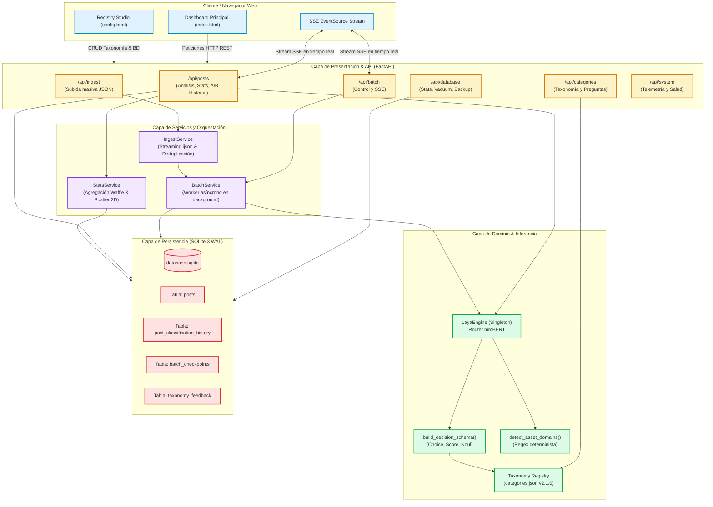
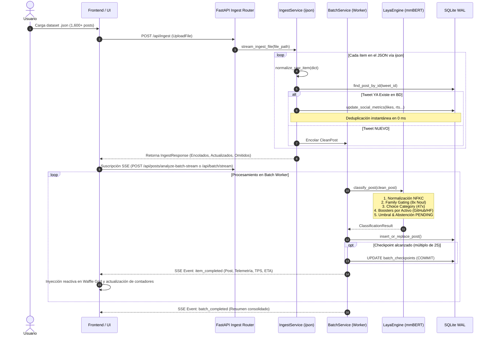

# 01 · Arquitectura y Diseño del Sistema

> **Proyecto:** `Twitter Post Classifier Master`  
> **Versión:** 2.1.0  
> **Motor de Inferencia:** JEV / TypeSafe System One (`convaiinnovations/laya` · mmBERT)  
> **Base de Datos:** SQLite 3 en modo Write-Ahead Logging (WAL) asíncrono  

---

## 🧭 1. Resumen Ejecutivo: ¿Qué es, Qué Hace y Cómo lo Hace?

### 1.1 ¿Qué es?
**Twitter Post Classifier Master** es un sistema de ingeniería de datos e inferencia semántica local diseñado para procesar, categorizar, enriquecer y visualizar grandes volúmenes de publicaciones extraídas de la plataforma **X (anteriormente Twitter)**. 

El sistema está especializado en comunidades técnicas y creativas: **Inteligencia Artificial (LLMs, difusión, visión), Blender 3D, Gráficos por Computadora, Desarrollo de Videojuegos, Herramientas de Software/Código, Manga/Ilustración Digital, Negocios/SaaS y Cultura General**.

```
┌────────────────────────────────────────────────────────────────────────────────────────┐
│                              TWITTER POST CLASSIFIER MASTER                            │
├────────────────────────────┬─────────────────────────────┬─────────────────────────────┤
│      1. INGESTA MASIVA     │    2. INFERENCIA SYSTEM 1   │   3. DASHBOARD ANALÍTICO    │
│                            │                             │                             │
│ • Streaming ijson (0 RAM)  │ • Inferencia local mmBERT   │ • Matriz Waffle Dinámica    │
│ • Deduplicación en 0 ms    │ • Multi-pregunta tipada     │ • Scatter 2D (Afinidad/Eng) │
│ • Checkpoints cada 25 posts│ • Family Gating determinista│ • Tabla Ejecutiva de ROI    │
│ • Streaming SSE en vivo    │ • Persistencia dual JSON    │ • Drawer con Rollback A/B   │
└────────────────────────────┴─────────────────────────────┴─────────────────────────────┘
```

### 1.2 ¿Qué Hace?
1. **Ingiere volcados masivos:** Procesa archivos JSON/NDJSON de scraping (ej. `meridian_twitter_scraper_v2`) sin saturar la memoria RAM.
2. **Deduplica inteligentemente en 0 ms:** Si un post ya existe en la base de datos, omite la inferencia neuronal y solo actualiza sus métricas sociales (*likes, retweets, replies, bookmarks*).
3. **Clasifica con precisión matemática:** Evalúa el contenido y los metadatos contra un árbol taxonómico de **8 familias raíz y 47 categorías especializadas**.
4. **Extrae metadatos complementarios:** Determina formato del post (*código, release, tutorial, showcase, hilo*), profundidad técnica (1.0 a 5.0), banderas booleanas (*Local-First, NSFW, Outlier, Tool Release*) y activos reproducibles (*GitHub, Hugging Face, Civitai, ComfyUI workflows*).
5. **Permite inspección y control humano:** Cuenta con un **Dashboard en Vivo**, una **Matriz Waffle**, un **Canvas Scatter 2D**, un **Drawer con comparativa A/B** para reclasificación instantánea y **JEV Registry Studio** para gobernar las categorías y preguntas.

### 1.3 ¿Cómo lo Hace?
A diferencia de los flujos convencionales basados en LLMs generativos comerciales (GPT-4, Claude), que sufren de alta latencia (~1.5 a 3.5 segundos por tweet), costos acumulativos elevados y alucinaciones de formato, este sistema emplea **JEV / TypeSafe System One**:
- Inferencia tipada basada en embeddings contextuales sobre un modelo encoder `mmBERT` local optimizado.
- En un **único forward pass**, resuelve múltiples preguntas estructuradas (`Choice`, `Score`, `Noul`).
- El proceso se ejecuta en **~5 a 20 ms en GPU NVIDIA CUDA** o **~30 a 50 ms en Apple Silicon (MPS)**, y alrededor de **~200 a 300 ms en CPU multicore**, garantizando privacidad 100% local, costo cero por API y determinismo tipado.

---

## 🎯 2. Ventajas Competitivas: System 1 vs LLMs Generativos

| Dimensión | LLMs Generativos (GPT-4o, Claude 3.5) | JEV / TypeSafe System One (Este Proyecto) |
| :--- | :--- | :--- |
| **Latencia por Post** | 1,500 ms – 4,000 ms | **5 ms – 25 ms (GPU) / ~200 ms (CPU)** |
| **Costo Operativo** | $0.005 – $0.03 por post ($50 / 10k posts) | **$0.00 (Inferencia Local en Hardware Propio)** |
| **Formato de Salida** | Texto libre propenso a parsing errors y JSON corrupto | **Juicios fuertemente tipados (Float, Enum, Int)** |
| **Privacidad de Datos** | Datos enviados a servidores externos de terceros | **100% On-Premise / Local-First** |
| **Determinismo** | Dependiente de temperatura y stochastic sampling | **Matemáticamente reproducible** |
| **Capacidad de Ingesta** | Limitada por Rate Limits (RPM / TPM) de la API | **Ilimitada (Saturación a velocidad de hardware)** |

---

## 🏗️ 3. Principios Fundamentales de Ingeniería

### 3.1 Dual JSON Persistence (Persistencia Dual JSON)
Cada publicación indexada en la tabla `posts` almacena simultáneamente dos estructuras de datos JSON completas:
1. `raw_json`: Contiene el objeto JSON íntegro original producido por el scraper (metadatos de autor, fechas ISO, URLs de fotos/videos originales, contadores brutos).
2. `classification_json`: Contiene la telemetría semántica completa generada por Laya Engine (respuestas crudas a cada pregunta tipada, scores de afinidad, latencia en ms, modelo utilizado y versión taxonómica).
*Beneficio:* Permite reproducir inferencias, entrenar clasificadores secundarios y auditar cambios de versión sin perder el contexto crudo del tweet original.

### 3.2 Family Gating (Anti-Colapso Léxico)
Un problema recurrente en la clasificación con decenas de clases es el **colapso léxico**: una publicación sobre un script en Python para Blender podría ser categorizada erróneamente como `dev_tools/scripts` en vez de `blender/addons` debido a la presencia de palabras clave de programación.  
*Mecanismo de Gating:* El motor evalúa primero 8 preguntas booleanas `Noul` correspondientes a las familias raíz (`is_family_ia`, `is_family_blender`, `is_family_modelado_3d`, etc.). Si una familia raíz recibe una probabilidad baja (<0.30), todas sus categorías hijas sufren una penalización de factor `0.15`, impidiendo falsos positivos inter-dominio.

### 3.3 Zero-Downtime Deduplication (Deduplicación en 0 ms)
En escenarios de ingesta periódica donde se descargan hilos o timelines con solapamientos temporales:
- El servicio consulta `find_post_by_id(tweet_id)`.
- Si el tweet ya existe, ejecuta una bifurcación rápida que actualiza contadores sociales (`favorite_count`, `retweet_count`, etc.) mediante un `UPDATE` ligero y **omite el forward pass del modelo de IA**.
- De este modo, 1,000 tweets repetidos se procesan en menos de 100 ms en lugar de gastar minutos de CPU/GPU.

### 3.4 Process Isolation & Prevención de OOM
La biblioteca PyTorch y los allocators de `glibc` en Linux acumulan fragmentación en la memoria residente (RSS) cuando se ejecutan cientos de inferencias o pruebas unitarias en un solo hilo monolítico.
- El sistema utiliza `torch.inference_mode()` para desactivar grafos de autograd.
- Se implementa `check_memory_safety()` con llamadas a `gc.collect()` y `malloc_trim(0)`.
- El test runner oficial (`scripts/run_all_tests.py`) aísla cada suite en subprocesos independientes para que el sistema operativo reclame el 100% de la memoria al finalizar cada batería de pruebas.

---

## 📐 4. Arquitectura de Capas (Diagrama C4)



---

## 🔄 5. Ciclo de Vida del Dato e Inferencia en Lote

El siguiente diagrama detalla la ruta de un tweet desde el archivo crudo de scraping hasta su renderizado en la matriz del frontend:



---

## 💾 6. Modelo de Datos y Esquema SQLite WAL

La persistencia del sistema está diseñada sobre SQLite 3 con configuración de alto rendimiento para soportar lecturas concurrentes sin bloqueo mientras el worker escribe lotes en segundo plano.

### 6.1 PRAGMAs de Conexión en `backend/app/database.py`
```sql
PRAGMA journal_mode = WAL;          -- Write-Ahead Logging: lecturas concurrentes sin bloqueo
PRAGMA synchronous = NORMAL;         -- Máxima velocidad de I/O preservando integridad ACID
PRAGMA busy_timeout = 5000;          -- Espera de hasta 5 segundos ante contención de bloqueos
PRAGMA cache_size = -64000;          -- ~64 MB de memoria caché en RAM para índices
PRAGMA foreign_keys = ON;            -- Integridad referencial habilitada
```

### 6.2 Tablas Principales

```
┌────────────────────────────────────────────────────────────────────────┐
│                                 POSTS                                  │
├───────────────────────────┬────────────┬───────────────────────────────┤
│ tweet_id                  │ TEXT (PK)  │ ID único del tweet en X       │
│ post_url                  │ TEXT       │ URL canónica a x.com          │
│ author_name               │ TEXT       │ Nombre de usuario del autor   │
│ author_id                 │ TEXT       │ ID numérico del autor en X    │
│ content                   │ TEXT       │ Texto íntegro del post        │
│ preview_text              │ TEXT       │ Snippet para tablas/listas    │
│ date                      │ TEXT       │ Fecha ISO de publicación      │
│ favorite_count            │ INTEGER    │ Contador de Likes             │
│ retweet_count             │ INTEGER    │ Contador de Retweets          │
│ reply_count               │ INTEGER    │ Contador de Respuestas        │
│ bookmark_count            │ INTEGER    │ Contador de Guardados         │
│ media_urls                │ TEXT(JSON) │ Array con URLs de medios      │
│ media_count               │ INTEGER    │ Cantidad de imágenes/videos   │
│ media_type                │ TEXT       │ 'video', 'photo' o 'none'     │
│ lang                      │ TEXT       │ Idioma ISO ('en', 'es', etc.) │
│ primary_category          │ TEXT       │ ID de categoría ganadora      │
│ secondary_categories      │ TEXT(JSON) │ Array con categorías y scores │
│ affinity_score            │ REAL       │ Certeza final (0.0 a 1.0)     │
│ format                    │ TEXT       │ 'code_release', 'tutorial'... │
│ format_confidence         │ REAL       │ Certeza del formato           │
│ technical_depth           │ REAL       │ Nivel de profundidad (1 a 5)  │
│ assets                    │ TEXT(JSON) │ Activos ('github_repo', etc.) │
│ is_local_first            │ INTEGER    │ Flag booleano (0 o 1)         │
│ is_nsfw                   │ INTEGER    │ Flag booleano (0 o 1)         │
│ is_outlier                │ INTEGER    │ Anomalía matemática (0 o 1)   │
│ status                    │ TEXT       │ CLASSIFIED, PENDING, DISCARDED│
│ engine_used               │ TEXT       │ 'laya' (modelo ejecutor)      │
│ inference_latency_ms      │ REAL       │ Tiempo de forward pass en ms  │
│ raw_json                  │ TEXT(JSON) │ Volcado original del scraper  │
│ classification_json       │ TEXT(JSON) │ Dictamen completo de Laya     │
│ taxonomy_version          │ TEXT       │ Versión de taxonomía activa   │
│ reclassification_count    │ INTEGER    │ Veces reclasificado (A/B)     │
│ created_at / updated_at   │ TIMESTAMP  │ Auditoría temporal            │
└───────────────────────────┴────────────┴───────────────────────────────┘
                                   │
                                   │ 1:N
                                   ▼
┌────────────────────────────────────────────────────────────────────────┐
│                      POST_CLASSIFICATION_HISTORY                       │
├───────────────────────────┬────────────┬───────────────────────────────┤
│ id                        │ INTEGER PK │ Identificador incremental     │
│ tweet_id                  │ TEXT (FK)  │ Referencia a posts(tweet_id)  │
│ version_number            │ INTEGER    │ Número de versión secuencial  │
│ taxonomy_version          │ TEXT       │ Versión de taxonomía usada    │
│ primary_category          │ TEXT       │ Categoría asignada en versión │
│ secondary_categories      │ TEXT(JSON) │ Categorías secundarias        │
│ affinity_score            │ REAL       │ Score en dicha versión        │
│ format / technical_depth  │ TEXT/REAL  │ Formato y nivel técnico       │
│ raw_answers               │ TEXT(JSON) │ Respuestas crudas del modelo  │
│ classification_json       │ TEXT(JSON) │ Snapshot completo de inferencia│
│ trigger_type              │ TEXT       │ initial_ingest, reclassify... │
│ reason                    │ TEXT       │ Justificación o nota humana   │
│ status                    │ TEXT       │ ARCHIVED o ROLLED_BACK        │
│ created_at                │ TIMESTAMP  │ Fecha y hora de archivado     │
└───────────────────────────┴────────────┴───────────────────────────────┘

┌────────────────────────────────────────────────────────────────────────┐
│                           BATCH_CHECKPOINTS                            │
├───────────────────────────┬────────────┬───────────────────────────────┤
│ batch_id                  │ TEXT (PK)  │ UUID identificador del lote   │
│ file_name                 │ TEXT       │ Archivo procesado             │
│ total_items               │ INTEGER    │ Posts totales en archivo      │
│ processed_items           │ INTEGER    │ Posts clasificados a disco    │
│ updated_metrics_items     │ INTEGER    │ Posts deduplicados en 0 ms    │
│ failed_items              │ INTEGER    │ Posts fallidos                │
│ last_processed_tweet_id   │ TEXT       │ Último post persistido        │
│ status                    │ TEXT       │ RUNNING, PAUSED, COMPLETED    │
│ checkpoint_interval       │ INTEGER    │ Intervalo de commit (ej. 25)  │
│ avg_latency_ms            │ REAL       │ Latencia promedio observada   │
│ created_at / updated_at   │ TIMESTAMP  │ Tiempos de ejecución          │
└───────────────────────────┴────────────┴───────────────────────────────┘

┌────────────────────────────────────────────────────────────────────────┐
│                           TAXONOMY_FEEDBACK                            │
├───────────────────────────┬────────────┬───────────────────────────────┤
│ id                        │ INTEGER PK │ Identificador incremental     │
│ tweet_id                  │ TEXT       │ Tweet corregido               │
│ original_content          │ TEXT       │ Texto evaluado                │
│ laya_suggested_category   │ TEXT       │ Categoría predicha por Laya   │
│ laya_confidence           │ REAL       │ Certeza de la predicción      │
│ resolved_category         │ TEXT       │ Categoría correcta final      │
│ resolved_by               │ TEXT       │ 'manual_user' o 'llm_fallback'│
│ created_at                │ TIMESTAMP  │ Fecha del ajuste              │
└───────────────────────────┴────────────┴───────────────────────────────┘
```

---

## ⚡ 7. Hardware Adaptativo: Inferencia en CPU, GPU y Apple Silicon

El sistema detecta automáticamente en tiempo de arranque el acelerador disponible mediante `backend/app/engine.py:resolve_device()`:

```
                  ┌──────────────────────────────┐
                  │ resolve_device('auto')       │
                  └──────────────┬───────────────┘
                                 │
                 torch.cuda.is_available()?
                 ┌───────────────┴───────────────┐
             SÍ  ▼                               ▼ NO
      ┌───────────────────────┐   torch.backends.mps.is_available()?
      │ Dispositivo: 'cuda'   │   ┌──────────────┴───────────────┐
      │ Aceleración NVIDIA    │ SÍ▼                              ▼ NO
      │ Latencia: ~5-20 ms    │ ┌───────────────────────┐ ┌───────────────────────┐
      └───────────────────────┘ │ Dispositivo: 'mps'    │ │ Dispositivo: 'cpu'    │
                                │ Apple Silicon Metal   │ │ Inferencia Vectorial  │
                                │ Latencia: ~30-50 ms   │ │ Latencia: ~200-300 ms │
                                └───────────────────────┘ └───────────────────────┘
```

El estado del acelerador se expone dinámicamente mediante el endpoint `/api/system/health` y se visualiza en el **Header** del frontend mediante badges en tiempo real.
