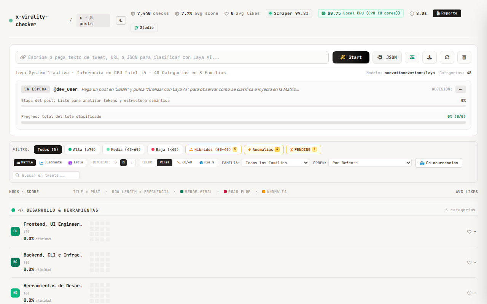

# 03 · Interfaz de Usuario, Experiencia y Dashboard Analítico

> **Diseño:** "Editorial Terminal" · Alta Densidad y Estética Analítica  
> **Framework:** TailwindCSS (CDN) + Vanilla JS ES6+ Modular  
> **Motor de Plantillas:** Jinja2 con Inclusión de Componentes y Modales  
> **Páginas Principales:** Dashboard (`/` · `index.html`) y JEV Registry Studio (`/config` · `config.html`)  

---

## 🎨 1. Filosofía de Diseño y Sistema Visual

La interfaz de usuario de **Twitter Post Classifier Master** fue construida bajo el principio de **"Editorial Terminal"**: una experiencia pensada para analistas de datos, ingenieros de IA e investigadores que demandan **máxima densidad de información sin saturación visual**, tipografía técnica de alta legibilidad y respuesta en tiempo real.

```
┌────────────────────────────────────────────────────────────────────────────────────────┐
│                              SISTEMA DE DISEÑO DEL PROYECTO                            │
├────────────────────────────┬─────────────────────────────┬─────────────────────────────┤
│         TIPOGRAFÍA         │       PALETA CROMÁTICA      │         MODOS VISUALES      │
│                            │                             │                             │
│ • JetBrains Mono (Datos)   │ • Base Neutra Cálida/Fría   │ • Modo Claro Calibrado      │
│ • Inter (Lectura y Copys)  │ • Acentos Semánticos Familias│ • Modo Oscuro OLED / Deep   │
│ • Pesos: 400, 500, 600, 700│ • Badges Hardware Dinámicos │ • Transiciones CSS Fluidas  │
└────────────────────────────┴─────────────────────────────┴─────────────────────────────┘
```

### 1.1 Paleta Cromática y Acentos de Familia
Cada una de las 8 familias raíz posee una firma cromática distintiva que se propaga coherentemente por las celdas de la Matriz Waffle, los puntos del Canvas Scatter, los badges de la Tabla Ejecutiva y los modales:

| Familia Raíz | Nombre Temático | Color HEX | Badge Visual |
| :--- | :--- | :--- | :---: |
| `ia` | Inteligencia Artificial & ML | `#8b5cf6` | <span style="color:#8b5cf6; font-weight:bold;">● Violeta</span> |
| `blender` | Blender 3D & Geometry Nodes | `#ea580c` | <span style="color:#ea580c; font-weight:bold;">● Naranja</span> |
| `modelado_3d` | Gráficos 3D, WebGL & Three.js | `#0284c7` | <span style="color:#0284c7; font-weight:bold;">● Azul Cielo</span> |
| `juegos` | Game Engines (Godot, Unreal, Unity) | `#10b981` | <span style="color:#10b981; font-weight:bold;">● Esmeralda</span> |
| `dev_tools` | Desarrollo Web, Código & Terminal | `#f59e0b` | <span style="color:#f59e0b; font-weight:bold;">● Ámbar</span> |
| `mangas` | Manga, Anime & Ilustración Digital | `#ec4899` | <span style="color:#ec4899; font-weight:bold;">● Rosa Neón</span> |
| `negocios_saas` | Startups, SaaS & Métricas MRR | `#059669` | <span style="color:#059669; font-weight:bold;">● Verde Jade</span> |
| `otros` | Conversación General & Memes | `#6b7280` | <span style="color:#6b7280; font-weight:bold;">● Gris Neutro</span> |

---

## 🧩 2. Arquitectura Modular del Frontend

El frontend se encuentra completamente desacoplado en componentes HTML y módulos de JavaScript independientes, garantizando mantenimiento limpio y cero dependencia de bundlers pesados:

```
frontend/
├── index.html                      # Punto de entrada Jinja2 del Dashboard
├── config.html                     # JEV Registry Studio v2.1.0
├── css/
│   └── styles.css                  # Estilos complementarios, keyframes y scrollbars
├── components/                     # Fragmentos Jinja2 reutilizables
│   ├── header.html                 # Barra superior, selector de tema y badge hardware
│   ├── live_scanner.html           # Escáner en vivo y doble barra de progreso
│   ├── filter_bar.html             # Filtros, buscador, selector de vistas y densidades
│   ├── views_container.html        # Contenedor de Waffle, Scatter y Tabla
│   ├── drawer.html                 # Drawer lateral de inspección profunda y A/B
│   └── footer_toast.html           # Overlays, tooltips flotantes y notificaciones
├── modals/                         # Modales de interacción y reporte
│   ├── ingest_modal.html           # Modal de carga masiva de archivos JSON
│   ├── taxonomy_modal.html         # Visor rápido de categorías
│   ├── overlap_modal.html          # Matriz de co-ocurrencia semántica
│   ├── pipeline_modal.html         # Inspección del esquema de inferencia
│   ├── exec_report_modal.html      # Reporte estratégico ejecutivo con métricas
│   ├── rich_post_modal.html        # Visor modal de publicación con medios
│   └── analysis_result_modal.html  # Visor JSON crudo del dictamen
└── js/                             # Controladores ES6+ modulares
    ├── api.js                      # Cliente HTTP centralizado y streaming SSE
    ├── core/
    │   ├── state.js                # Estado reactivo global del cliente
    │   └── utils.js                # Formateo de fechas, números y helpers DOM
    ├── data.js                     # Gestión y caché de posts en memoria
    ├── matrix.js                   # Renderizado y lógica de celdas Waffle Grid
    ├── views.js                    # Cuadrante Scatter Canvas 2D y Tabla Ejecutiva
    ├── drawer.js                   # Controlador del drawer lateral y comparativa A/B
    ├── modals.js                   # Coordinador de modales y aperturas
    ├── modals/                     # Lógica interna de cada modal
    └── app.js                      # Orquestador principal y listeners globales
```

---

## 🖥️ 3. Componentes y Vistas del Dashboard Principal


### 3.1 Header y Badge de Telemetría de Hardware
Ubicado en la parte superior, provee control de navegación y telemetría de infraestructura:
- **Selector de Tema:** Alterna entre modo claro cálido y modo oscuro de alto contraste.
- **Botón Ingesta Masiva (`#openIngestModalBtn`):** Despliega el gestor de subida de volcados JSON.
- **Acceso a JEV Registry Studio:** Enlace directo a `/config` para gobernar categorías y preguntas.
- **Badge de Aceleración de Hardware (`#hardwareBadge`):** 
  - Detecta dinámicamente si el motor corre sobre **GPU NVIDIA CUDA**, **Apple Silicon (MPS)** o **CPU Vectorial**.
  - Muestra indicador verde de latencia estimada (`~5ms/post` en GPU vs `~200ms/post` en CPU) y memoria en uso.



---

### 3.2 Escáner en Vivo y Streaming SSE (`Live Scanner`)
Al iniciarse una ingesta o procesamiento masivo, el componente `#liveScannerContainer` se despliega automáticamente:
- **Barra de Progreso Acumulado:** Muestra el porcentaje total completado del lote.
- **Micro-Barra del Post Activo:** Visualiza el progreso atómico de clasificación de la publicación en curso.
- **Telemetría Reactiva:** Indicador en tiempo real de publicaciones por segundo (**TPS**), tiempo estimado de finalización (**ETA**) y consumo de memoria RAM.
- **Preview del Tweet Activo:** Visualiza el avatar del autor, texto entrante y cambio reactivo de insignias semánticas según la inferencia emitida por Laya.


---

### 3.3 Barra de Filtros, Búsqueda y Densidades
Permite segmentar y explorar dinámicamente las publicaciones:
1. **Buscador en tiempo real (`#searchInput`):** Filtra por texto del contenido o nombre del autor con *debounce* de 200 ms.
2. **Selector de Familia Temática (`#familySelect`):** Limita la vista a cualquiera de las 8 familias raíz.
3. **Selector de Categoría Específica (`#categorySelect`):** Filtro granular sobre las 47 categorías técnicas.
4. **Selector de Estado (`#statusSelect`):** Permite aislar publicaciones `CLASSIFIED`, `PENDING` (abstención) o `DISCARDED`.
5. **Filtro de Anomalías / Outliers (`#outlierFilterBtn`):** Aísla publicaciones con viralidad desproporcionada respecto a su especificidad técnica.
6. **Conmutador de Densidad de Cuadrícula:** Alterna el tamaño de celdas de la Matriz Waffle entre **S (Compacta)**, **M (Estándar)** y **L (Expandida)**.
7. **Conmutador de Vistas:** Permite alternar instantáneamente entre la **Matriz Waffle**, el **Cuadrante Scatter Canvas 2D** y la **Tabla Analítica**.

---

### 3.4 Vista 1: Matriz Waffle Dinámica (`Waffle Grid`)
Es la vista insignia del sistema. Modela visualmente la distribución de publicaciones como una matriz espacial proporcional agrupada por familias temáticas:


- **Distribución por Bloques de Familia:** Cada familia organiza sus categorías hijas en filas horizontales.
- **Celdas Proporcionales:** Cada celda representa una publicación. El color dominante corresponde a la categoría primaria.
- **Visualización Split / Pie Diagonal 60/40:** Cuando una publicación posee una categoría secundaria relevante (score ≥0.35), la celda se divide en una diagonal bicromática (60% color primario / 40% color secundario).
- **Aislamiento de Publicaciones `PENDING`:** Aquellas publicaciones donde el clasificador se abstuvo por falta de confianza se identifican inmediatamente mediante un borde ámbar pulsante, facilitando la supervisión humana.


---

### 3.5 Vista 2: Cuadrante Scatter Canvas 2D (`Afinidad vs Engagement`)
Renderizado en un elemento HTML5 `<canvas>` optimizado para trazado de alto rendimiento:


- **Eje X (Horizontal):** Puntuación de Afinidad Semántica (0.0% a 100.0%).
- **Eje Y (Vertical):** Métricas de Engagement (Likes / Retweets en escala ajustada).
- **Los 4 Cuadrantes Analíticos:**
  1. *Cuadrante Superior Derecho (Alta Afinidad / Alto Engagement):* **Gemas Virales**. Contenido técnico de máxima relevancia con gran tracción comunitaria.
  2. *Cuadrante Inferior Derecho (Alta Afinidad / Bajo Engagement):* **Joyas Ocultas**. Publicaciones altamente especializadas con repositorios o código que pasaron desapercibidas por el algoritmo de X.
  3. *Cuadrante Superior Izquierdo (Baja Afinidad / Alto Engagement):* **Outliers / Ruido Viral**. Tweets populares con poca relevancia técnica.
  4. *Cuadrante Inferior Izquierdo (Baja Afinidad / Bajo Engagement):* **Descartes Semánticos**.
- **Tooltip Flotante Interactivo (`#scatterTooltip`):** Al posar el cursor sobre cualquier nodo, se despliega una tarjeta flotante con el texto del tweet, autor, métricas exactas y botón de apertura en el Drawer lateral.


---

### 3.6 Vista 3: Tabla Analítica Ejecutiva (`Executive Table`)
Diseñada para análisis tabular denso y exportación rápida de información:


- **Columnas Configurables:** Autor, Categoría Primaria con badge cromático, Formato, Afinidad (%), Engagement Total, Indicador de Activo reproducible y Acciones.
- **Cálculo de ROI de Atención:** Evalúa la relación entre la profundidad técnica del contenido y la tracción recibida.
- **Enlaces Directos:** Cada fila cuenta con enlace directo al tweet original en `x.com` y botón de inspección profunda en el Drawer.

---

### 3.7 Drawer Lateral de Inspección y Reclasificación A/B
El panel `#detailDrawer` se desliza desde el lateral derecho sin interrumpir el contexto de navegación:

- **Inspección Multimedia:** Muestra el texto íntegro, fecha ISO, autor con avatar y reproductor embebido de fotos o videos asociados.
- **Desglose de Inferencia System 1:**
  - Categoría primaria y secundarias con barras de progreso de probabilidad.
  - Formato clasificado (*código, tutorial, release, showcase, thread*).
  - Profundidad técnica (representada en estrellas de 1 a 5).
  - Activos reproducibles detectados (*GitHub, Hugging Face, Civitai, ComfyUI*).
- **Comparativa A/B en Vivo (`Reclassify`):**
  - Permite re-evaluar la publicación en caliente tras modificar preguntas o umbrales.
  - Muestra un desglose diferencial (delta de afinidad, cambio de categoría anterior vs sugerida).
- **Historial Cronológico de Versiones & Rollback:**
  - Registra cada versión anterior de la clasificación con su fecha, motivo y responsable.
  - Cuenta con botón de **Rollback atómico** que restaura cualquier versión previa en la base de datos con un solo clic.

---

### 3.8 Modales Analíticos Especializados

| Modal | ID del DOM | Propósito y Capacidades | Captura de Referencia |
| :--- | :--- | :--- | :---: |
| **Ingesta Masiva** | `#ingestModal` | Selector de archivo JSON/NDJSON, opciones de deduplicación y estimación de tiempo. |  |
| **Taxonomía** | `#taxonomyModal` | Matriz navegable de las 47 categorías agrupadas por familias con sus descripciones. |  |
| **Reporte Estratégico** | `#execReportModal` | Informe ejecutivo consolidado con métricas de engagement, categorías dominantes y KPIs de ROI. |  |
| **Co-ocurrencias** | `#overlapModal` | Análisis matricial de solapamiento semántico entre categorías secundarias y primarias. | — |
| **Pipeline Inferencia**| `#pipelineModal` | Inspección del esquema de decisión tipado activo y parámetros del modelo mmBERT. | — |
| **Visor Enriquecido** | `#richPostModal` | Vista expandida tipo tarjeta de alta fidelidad para lectura focalizada de un tweet. | — |

---

## 🛠️ 4. JEV Registry Studio (`/config.html`)

**JEV Registry Studio** es el panel de control y calibración de **TypeSafe System One**. Permite gobernar las reglas de clasificación, la taxonomía y la base de datos en caliente:

### 4.1 Pestaña 1: Árbol de Categorías y Familias (`tab-categories`)
- Permite crear, editar y dar de baja categorías técnicas.
- Configuración de colores hex, palabras clave, activos asociados y prioridad.
- Asignación de umbrales personalizados con soporte de herencia (*Categoría -> Familia -> Default 0.75*).

### 4.2 Pestaña 2: Configuración Global de Scoring (`tab-globals`)
- Ajuste de pesos del algoritmo de inferencia:
  - Ponderación de Family Gating (+0.15 / penalización 0.15).
  - Bonificación por activos reproducibles (+0.20).
  - Bonificación por especificidad (+0.05).
  - Bonificación por coincidencia léxica (+0.08).
- Configuración de detectores de dominios reproducibles por regex.

### 4.3 Pestaña 3: Banco de Preguntas Tipadas (`tab-questions`)
- Administrador visual de las preguntas estructuradas de System 1:
  - Preguntas `Choice` (selección discreta de formato o activo).
  - Preguntas `Score` (profundidad técnica 1 a 5).
  - Preguntas `Noul` (certeza booleana de familia y banderas de seguridad).
- Interruptor de activación/desactivación en caliente para excluir o incluir preguntas en el pipeline sin tocar código.


### 4.4 Pestaña 4: Simulador y Calibrador de Reglas (`tab-rules`)
- Laboratorio interactivo para probar posts arbitrarios contra las preguntas y categorías activas.
- Muestra el árbol de decisiones y el cálculo desglosado de puntuación sin alterar la base de datos.

### 4.5 Pestaña 5: Centro de Control SQLite WAL (`tab-database`)
- Muestra estadísticas físicas de la base de datos: tamaño del archivo `.sqlite`, tamaño del diario `.sqlite-wal` y conteo de filas por tabla.
- **Optimizar Base de Datos:** Ejecuta `VACUUM;` y compacta el diario WAL a cero bytes.
- **Exportar Respaldo:** Descarga un snapshot completo de publicaciones e historial en formato JSON.
- **Importar Respaldo:** Combina o sobreescribe datos a partir de respaldos previos.
- **Reinicio Controlado:** Limpia tablas de publicaciones manteniendo opcionalmente la memoria de feedback humano.


