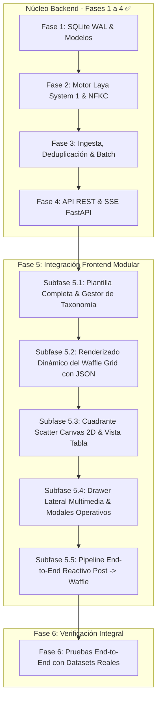

# Plan de Implementación Maestro: `twitter-post-classifier` (Dashboard & Inferencia System 1)

**Ubicación Principal del Proyecto:** `/home/patricklinux/Dev/GEMINI-ANTIGRAVITY APPS/JEV_APPS/twitter_post_classifier_master`  
**Referencia de Diseño y Plantilla UI:** `/home/patricklinux/Dev/GEMINI-ANTIGRAVITY APPS/JEV_APPS/x_category_matrix_dashboard`  
**Base de Conocimiento y Taxonomía:** `Obsidian / Cerebro Digital / Desarrollo_Software / AppS_JEV / twitter-post-classifier`  
**Versión del Plan:** 2.2.0 (Reestructurado para Integración Modular del Frontend y Gestión Taxonómica)  
**Fecha de Actualización:** 2026-10-14  

---

## 1. Visión y Diagnóstico de Estado

La aplicación master unifica el dashboard de visualización matricial (`x_category_matrix_dashboard`) con un backend robusto en **FastAPI**, motor de inferencia local **Laya System 1** (ModernBERT/mmBERT), persistencia en **SQLite WAL**, ingesta inteligente con deduplicación estricta y procesamiento masivo con checkpoints.

### Estado Actual del Núcleo Backend (Fases 1 a 4 Completadas):
- **Persistencia (Fase 1):** Base de datos SQLite WAL con tablas `posts`, `batch_checkpoints`, `taxonomy_feedback` e índices de alto rendimiento.
- **Motor System 1 (Fase 2):** Inferencia en CPU pura (Intel Core i5-10210U) con límite de 4 hilos, normalización Unicode NFKC (japonés/inglés), Family Gating anti-colapso léxico y boosters calibrados.
- **Servicios de Negocio (Fase 3):** Ingesta streaming con `ijson`, deduplicación estricta (0 ms Laya en existentes, actualiza solo likes/retweets), Batch Runner en segundo plano y agregador de estadísticas.
- **API REST y SSE (Fase 4):** Endpoints `/api/posts`, `/api/posts/stats`, `/api/ingest`, `/api/batch` y `/api/system/health`.
- **Suite de Pruebas:** 19 tests automatizados pasando al 100%.

### Nuevo Enfoque de Integración del Frontend:
El frontend no debe conectarse en un solo bloque monolítico. Se divide la **Fase 5 en subfases incrementales** centradas en la experiencia de usuario:
1. **Primero la vista principal completa:** Desplegar y visualizar la plantilla completa de forma autónoma.
2. **Subfase 5.1:** Integración de la plantilla base y del módulo de **Taxonomía de Categorías** (listar y crear categorías persistidas en el JSON desde el frontend y sincronizadas con el backend).
3. **Subfase 5.2:** Renderizado dinámico del **Waffle Grid** con las categorías reales del JSON agrupadas por familias.
4. **Subfase 5.3:** Cuadrante Scatter Canvas 2D y vista tabular.
5. **Subfase 5.4:** Drawer lateral de inspección y modales operativos (PENDING e Ingesta SSE).
6. **Subfase 5.5:** Pipeline reactivo integral (análisis con Laya -> guardado en SQLite -> visualización en tiempo real en la celda correspondiente).

---

## 2. Hoja de Ruta de Implementación Detallada

---

### Subfase 5.1: Integración Visual de la Plantilla Base y Gestor de Taxonomía de Categorías

**Objetivo:** Obtener la vista principal completa navegable en el navegador y habilitar la administración de la taxonomía (listar y crear categorías reflejadas en `categories.json`).

#### 1. Integración de la Plantilla Completa en la App:
- Copiar y estructurar los activos de `x_category_matrix_dashboard` en `twitter_post_classifier_master/frontend/`:
  - `index.html`: Layout unificado (Header con telemetría, Toolbar, contenedor de vistas, Drawer lateral, Modales).
  - `css/styles.css`: Estilos visuales, paletas de familias, celdas bicolores (`60/40`, `Pie %`, `Viral`) y animaciones de outlier.
  - `js/`: Separación modular y reactiva.
- Configurar FastAPI para servir la app en `http://localhost:8000` con visualización inmediata, manteniendo la capacidad de operar en modo autónomo/mock mientras se enlazan los servicios.

#### 2. Módulo de Taxonomía de Categorías (`#taxonomyModal`):
- En la plantilla de referencia se define:
  > *"Define las categorías contra las cuales la IA clasificará las publicaciones del JSON."*
- **Listado Dinámico:** El contenedor `#taxonomyList` debe renderizar las categorías leyendo directamente desde `categories.json` (vía `GET /api/categories`). Cada fila muestra:
  - Código badge con color distintivo (ej. `IA`, `BL`, `3D`, `MG`, etc.).
  - Nombre canónico de la categoría y familia raíz a la que pertenece.
  - Palabras clave y umbral de activación.
  - Botón de desactivar/eliminar.
- **Creación de Nuevas Categorías:**
  - Formulario en el modal: Código (`#newCatCode`), Nombre (`#newCatName`), Palabras clave (`#newCatKeywords`), Familia raíz (`#newCatFamily`) y Color (`#newCatColor`).
  - Al pulsar `+ Añadir`:
    * Envía una petición `POST /api/categories`.
    * El backend valida la categoría, la inserta en `backend/data/categories.json`, la guarda a disco y recarga en caliente la taxonomía en memoria (`load_registry_data(reload=True)`).
    * Laya Router recompila el esquema de decisión automáticamente sin necesidad de reiniciar el servidor.
    * La UI actualiza la lista del modal y emite notificación toast de éxito.

#### 3. Soporte en el Backend para Subfase 5.1:
- **`GET /api/categories`:** Retorna la lista ordenada de todas las categorías activas con código, label, familia, umbral, boosters y color.
- **`POST /api/categories`:** Endpoint para crear y persistir nuevas categorías en `categories.json`.

---

### Subfase 5.2: Renderizado Dinámico del Waffle Grid con Taxonomía Real

**Objetivo:** Reemplazar las categorías provisionales del prototipo por las categorías oficiales del JSON en la cuadrícula Waffle principal.

#### 1. Adaptación de `matrix.js`:
- El Waffle Grid debe renderizar las filas agrupadas por las **8 familias maestras**:
  1. `ia` (Inteligencia Artificial General, Local, Generativa, ComfyUI, etc.)
  2. `blender` (Geometry Nodes, Animation Rigs, Cycles Render, Addons, etc.)
  3. `modelado_3d` (Gráficos 3D, WebGL/Three.js, Shaders, Sculpting)
  4. `juegos` (GameDev General, Unity, Unreal Engine, Godot)
  5. `dev_tools` (Web Dev, Backend Infra, CLI Rust, Open Source Tools)
  6. `mangas` (Manga Anime Art, Webcomics, Ilustración Digital)
  7. `negocios_saas` (SaaS Bootstrapping, MRR Build in Public, Marketing)
  8. `otros` (Cultura Digital, Memes, Discusión General)
- Cada fila de categoría muestra:
  - Header de categoría con badge de color, código, nombre, contador de posts y afinidad promedio.
  - Contenedor de celdas con soporte de modos de renderizado:
    * **Bicolor 60/40:** División proporcional según categoría primaria y secundaria.
    * **Pie %:** Gráfico radial de peso temático.
    * **Viral:** Tamaño o brillo reactivo al volumen de likes/engagement.
    * **Ghost Linking:** Conexión visual sutil al pasar el cursor sobre posts híbridos.
  - Selector de densidad reactivo:
    * `S` (Small): Celdas compactas de 12px para alta densidad.
    * `M` (Medium): Celdas estándar de 20px.
    * `L` (Large): Celdas amplias de 28px con detalle tipográfico.

#### 2. Sincronización Unificada Frontend-Backend:
- Las categorías mostradas en el Waffle Grid son **exactamente las mismas** que se listan y administran en el modal de taxonomía.
- Si el usuario añade una categoría en la Subfase 5.1, la nueva categoría aparece de inmediato como una nueva fila en el Waffle Grid bajo su familia correspondiente.

---

### Subfase 5.3: Integración del Cuadrante Scatter Canvas 2D y Vista Tabla

**Objetivo:** Incorporar las vistas de análisis complementarias con interactividad bidireccional.

#### 1. Cuadrante Scatter Canvas 2D (`scatter.js`):
- Gráfico de alta fidelidad renderizado sobre Canvas 2D HTML5.
- Ejes coordenados:
  - Eje X: **Score de afinidad algorítmica** ($0$ a $100\%$).
  - Eje Y: **Métricas de virality / Engagement** (Likes en escala logarítmica o lineal).
- Interactividad completa:
  - Zoom con rueda del ratón y arrastre (Pan).
  - Hover reactivo con tooltip mostrando autor, fragmento del tweet y categoría primaria/secundaria.
  - Outliers algorítmicos resaltados con anillo ámbar pulsante.
  - Clic en cualquier punto: Abre automáticamente el Drawer lateral de inspección con ese post.

#### 2. Vista Tabular Alternativa (`views.js`):
- Pestaña para alternar entre Waffle Grid, Cuadrante Scatter y Vista Tabla.
- Tabla con ordenamiento dinámico por fecha, score de afinidad o likes, y filtros por familia e idioma.

---

### Subfase 5.4: Drawer Lateral de Inspección y Modales Operativos

**Objetivo:** Interacción profunda con publicaciones individuales, resolución de abstenciones y carga masiva.

#### 1. Drawer Lateral de Inspección (`drawer.js`):
- Despliegue lateral animado al hacer clic sobre cualquier celda de la cuadrícula o punto del Scatter.
- **Reproductor Multimedia HTML5:**
  - Si el post contiene video (`.mp4` de X), renderiza `<video controls autoplay loop>` con controles nativos.
  - Si contiene imágenes, galería fotográfica con lightbox.
- **Metadatos Técnicos:** Desglose del análisis de Laya (formato, profundidad técnica 1-5, assets reproducibles detectados como GitHub o Hugging Face, flag NSFW y local-first).
- **Acciones:** Enlace directo al tweet original en X (`https://x.com/...`) y botón de reclasificación rápida.

#### 2. Centro de Resolución de Posts `PENDING` (`pending_modal.js`):
- Contador en la barra superior con badge ámbar reactivo: `⚠️ PENDING (N)`.
- Modal con tarjetas interactivas de publicaciones en abstención:
  - Muestra los **Top-3 candidatos de Laya** con botones de asignación en 1 clic.
  - Buscador taxonómico en vivo entre las 47 categorías oficiales.
  - Botón de descarte.
  - Al resolver, llama a `POST /api/posts/{tweet_id}/override` y actualiza la matriz en caliente.

#### 3. Modal de Ingesta & Lotes con Streaming SSE (`batch_modal.js`):
- Drag & Drop para cargar volcados JSON del scraper.
- Pantalla de reporte previo de deduplicación (Tweets nuevos a clasificar vs Tweets existentes con métricas refrescadas).
- Barra de progreso conectada al flujo SSE `/api/batch/stream/{batch_id}` mostrando TPS, uso de CPU, RAM del host y tiempo estimado (ETA).

---

### Subfase 5.5: Pipeline End-to-End Reactivo (Análisis → Persistencia → Visualización)

**Objetivo:** Probar el ciclo completo en vivo:
1. Ingestar un JSON con tweets reales (en inglés, español y japonés).
2. El Batch Runner clasifica en segundo plano con Laya System 1 sin congelar la interfaz.
3. Los posts clasificados se persisten en SQLite WAL con commits cada 25 items.
4. Conforme cada lote de 25 se confirma, la cuadrícula Waffle y el gráfico Scatter se actualizan en vivo, mostrando los nuevos posts en sus celdas correspondientes.

---

### Subfase 5.8: Drawer Lateral Multimedia, Vista Completa y Resolución Interactiva PENDING [COMPLETADA]

**Objetivo:** Transformar el Drawer Lateral y `#richPostModal` en herramientas profesionales de auditoría analítica y supervisión humana con soporte para videos MP4 reales de Twitter/Meridian, desglose semántico fiel con PyTorch CPU, visor dual JSON (raw Meridian vs Laya AI) y reclasificación en caliente por familias maestras persistida en SQLite WAL y tabla `taxonomy_feedback`.

---

### Subfase 5.9: Refactorización y Modularización Arquitectónica del Frontend [COMPLETADA]

**Objetivo:** Desacoplar la vista monolítica `frontend/index.html` (de 1,423 líneas a 87 líneas) mediante una arquitectura modular limpia y escalable:
1. **13 Componentes y Modales:** Extracción modular bajo `frontend/components/` (6 componentes) y `frontend/modals/` (7 modales).
2. **FastAPI + Jinja2Templates:** Servicio transparente del frontend ensamblado dinámicamente en `GET /` sin fricción en desarrollo.
3. **Compilador Autónomo (`scripts/build_frontend.py`):** Pre-renderizado estático a `frontend/dist/index.html` (81 KB) para distribución offline y sincronización de assets `css/` y `js/`.
4. **Cliente API Centralizado (`frontend/js/api.js`):** Interfaz tipada `window.API` para `categories`, `posts` y `system` con control de errores unificado.
5. **Cero Regresiones DOM:** 100% de preservación de IDs y clases, verificado con 52 selectores mediante suite automatizada Playwright E2E.

### Subfase 5.10: JEV Registry Studio v2.1.0 (Configuración General de Decisiones & Taxonomía CRUD) [COMPLETADA]

**Objetivo:** Transformar el modal básico de taxonomía en una suite completa de configuración y gobernanza semántica accesible en la misma pestaña mediante `/config`:
1. **JEV Registry Studio v2.1.0 (`frontend/config.html` y `frontend/js/config.js`):** Interfaz completa con 4 pestañas operativas (Taxonomía & Categorías con grid de 48 tarjetas y CRUD modal, Ajustes Globales & Boosters, Banco de Preguntas Tipadas System 1, y Reglas de Decisión & Desempate).
2. **Backend CRUD Extendido con Persistencia Atómica:** Endpoints completos en `endpoints_categories.py` para categorías, ajustes globales y preguntas, con reemplazo atómico en disco en `categories.json` y recarga en caliente de `LayaEngine` y `DecisionSchema`.
3. **Blindaje de Familias y Preguntas Canónicas:** Protección estricta contra eliminación de las 8 familias raíz (`ia`, `blender`, `modelado_3d`, `juegos`, `dev_tools`, `mangas`, `negocios_saas`, `otros`) y preguntas canónicas para garantizar la estabilidad del gating semántico.
4. **Reasignación SQLite WAL:** Limpieza automática de publicaciones asociadas a categorías eliminadas reasignándolas a `'otros'` en estado `PENDING`.
5. **Simulador Multi-Label RLCD (31 ms):** Simulador interactivo en navegador con cálculo determinista de bonificaciones por dominio (`github.com/`, `huggingface.co/`, etc.) y desglose de `boosted_score`.
6. **Verificación Automatizada E2E:** 6 pruebas unitarias backend (0.28s) y 8 pasos de validación Playwright en Chromium con 6 capturas de pantalla de alta fidelidad.

### Subfase 5.11: Refactorización y Modularización Arquitectónica de la Lógica JavaScript [COMPLETADA]

**Objetivo:** Eliminar los cuellos de botella monolíticos en la capa JavaScript desacoplando `config.js` (1,397 líneas) y `modals.js` (1,230 líneas) en módulos independientes, cohesivos y fuertemente organizados:
1. **Modularización de Config Studio (`frontend/js/config/`):** Desarticulación de `config.js` en 6 módulos especializados (`state.js`, `categories.js`, `globals.js`, `questions.js`, `simulator.js`, `app.js`), reduciendo el archivo base a una fachada retrocompatible de 31 líneas (-97.8%).
2. **Desacoplamiento de Modales y Purga de Código Muerto (`frontend/js/modals/`):** Extracción de 6 módulos modales (`rich_post_modal.js`, `ingest_modal.js`, `overlap_modal.js`, `exec_report_modal.js`, `analysis_result_modal.js`, `pipeline_modal.js`). Reducción de `drawer.js` de 836 a 392 líneas (-53.1%) y de `modals.js` de 1,230 a 21 líneas (-98.3%), purgando más de 175 líneas de código legado.
3. **Capa Core Compartida (`frontend/js/core/`):** Creación de `utils.js` (utilidades puras para formateo, escape y anomalías) y `state.js` (store reactivo canónico `AppState` con sincronización bidireccional global), optimizando `data.js` a 376 líneas.
4. **Compilador Offline Autónomo (`scripts/build_frontend.py`):** Pre-renderizado Jinja2 tanto de `index.html` (82 KB) como de `config.html` (58 KB) y sincronización recursiva de los 22 módulos JS a `frontend/dist/`.
5. **Auditoría Graphify MCP & Pruebas E2E:** 694 nodos y 38 comunidades cohesivas sin God Nodes frontend. 100% de éxito en 6 pruebas unitarias backend y 2 suites E2E con Playwright (52 selectores en dashboard y 8 pasos en Config Studio).

---

## 3. Matriz de Endpoints y Contratos

| Método | Endpoint | Descripción | Subfase |
| :--- | :--- | :--- | :---: |
| `GET` | `/api/categories` | Lista todas las categorías del registro JSON con metadatos. | 5.1 / 5.10 |
| `POST` | `/api/categories` | Añade y persiste una nueva categoría en `categories.json`. | 5.1 / 5.10 |
| `GET` | `/api/categories/{id}` | Obtiene detalle enriquecido de una categoría (directiva, keywords, boosters). | 5.10 |
| `PUT` | `/api/categories/{id}` | Actualiza metadatos, umbrales y directivas con persistencia atómica. | 5.10 |
| `DELETE` | `/api/categories/{id}` | Elimina subcategoría y reasigna posts a `'otros'` en SQLite WAL. | 5.10 |
| `GET` | `/api/categories/settings/globals` | Obtiene ajustes globales del pipeline y matriz de scoring. | 5.10 |
| `PUT` | `/api/categories/settings/globals` | Modifica umbrales globales, fallbacks y límites multi-label. | 5.10 |
| `GET` | `/api/categories/questions/supplementary` | Lista preguntas tipadas System 1 (Choice, Score 1-5, Noul). | 5.10 |
| `POST` | `/api/categories/questions/supplementary` | Registra una nueva pregunta suplementaria en el motor Laya. | 5.10 |
| `PUT` | `/api/categories/questions/supplementary/{q_id}` | Actualiza directivas o choices de una pregunta tipada. | 5.10 |
| `DELETE` | `/api/categories/questions/supplementary/{q_id}` | Elimina pregunta suplementaria no protegida. | 5.10 |
| `GET` | `/config` | Sirve la suite JEV Registry Studio v2.1.0 (Laya Decision Engine). | 5.10 |
| `GET` | `/api/posts/stats` | Métricas agregadas para la Waffle Grid y Cuadrante Scatter. | 5.2 / 5.3 |
| `GET` | `/api/posts` | Lista paginada de publicaciones con filtros dinámicos. | 5.2 / 5.3 |
| `GET` | `/api/posts/{id}` | Inspección profunda de un tweet para el Drawer lateral. | 5.4 |
| `POST` | `/api/posts/{id}/override` | Reclasifica un post en estado `PENDING`. | 5.4 |
| `POST` | `/api/ingest` | Carga multipart de JSON con deduplicación y reporte. | 5.4 |
| `POST` | `/api/batch/start/{id}` | Inicia o reanuda un lote de procesamiento. | 5.4 |
| `POST` | `/api/batch/pause/{id}` | Pausa un lote tras el checkpoint actual. | 5.4 |
| `GET` | `/api/batch/stream/{id}` | Stream SSE de telemetría de hardware y progreso. | 5.4 |
| `GET` | `/api/system/health` | Estado de CPU Intel Core i5, memoria RAM y Laya. | 5.1 |

---

## 4. Estado de Ejecución
Todas las subfases de la **Fase 5 (Subfases 5.1 a 5.15)** y la **Fase 6 (Ingesta Masiva, Perfilado de Memoria y Streaming SSE)** han sido implementadas, verificadas y documentadas en sus respectivos resúmenes ejecutivos.

---

## 5. Directorio de Evidencias Visuales y Capturas E2E

Todas las capturas de pantalla oficiales generadas durante los ciclos de verificación en navegador con Playwright se encuentran centralizadas y organizadas en:
- **Directorio dedicado:** [`documentacion/imagenes/`](imagenes/README.md)
- **Acceso compatible:** `documentacion/images/`
- **Catálogo de evidencias y vistas previas:** [Catálogo de Evidencias Visuales](imagenes/README.md)

