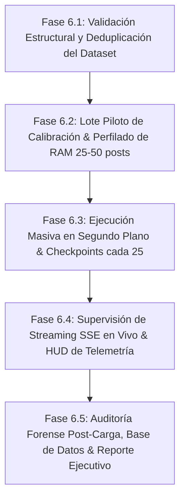

# Plan de Ejecución: Fase 6 - Ingesta Masiva, Monitoreo de Hardware, Checkpoints y Validación E2E en Producción

**PROYECTO:** `twitter-post-classifier-master`  
**DATASET OBJETIVO:** `/home/patricklinux/Dev/GEMINI-ANTIGRAVITY APPS/automations/output_files/twitter/extracted_links/extracted_data_https___x_com_i_bookmarks_bookmarks_20261013_101533.json`  
**VOLUMEN DEL DATASET:** 1,683 publicaciones de X/Twitter (2.3 MB)  
**MOTOR DE INFERENCIA:** Laya System 1 en CPU pura (Intel Core i5-10210U, 4 cores / 8 threads, 3 hilos PyTorch)  
**PERSISTENCIA:** SQLite WAL con checkpoints transaccionales cada 25 publicaciones  
**FECHA:** 16 de Octubre, 2026  

---

## 1. Visión General del Objetivo

El objetivo de la **Fase 6** es someter la arquitectura completa a su primera prueba de estrés y carga masiva en condiciones reales de producción, ingesting y clasificando los 1,683 bookmarks extraídos por el scraper de Meridian. 

El plan evalúa:
1. La estabilidad y rendimiento del motor Laya en CPU (latencia por post, Throughput / TPS).
2. La persistencia transaccional y checkpoints en SQLite WAL cada 25 publicaciones.
3. El perfil de consumo de memoria RAM del proceso y del host, auditando la ausencia de fugas de memoria (*memory leaks*) por acumulación de buffers o arenas de `glibc`.
4. La supervisión reactiva en tiempo real mediante Streaming SSE (`/api/batch/stream/{batch_id}`) y el HUD de telemetría de hardware.
5. El comportamiento del frontend (Waffle Grid, Scatter Canvas y Reporte Ejecutivo) al procesar y visualizar un catálogo masivo en vivo.

---

## 2. Hallazgos del Análisis Preliminar y Diagnóstico de Componentes

### 2.1 Inspección del Dataset (`extracted_data_...json`)
* **Estructura:** Diccionario raíz con metadatos y array `posts` conteniendo exactamente **1,683 publicaciones**.
* **Esquema:** Compatible con el formato canónico de Meridian (`tweet_id`, `post_url`, `author`, `content`, `preview_text`, `date`, `metrics`, `media_urls`, `media_count`, `category`).
* **Diversidad de Contenido:** Publicaciones en inglés, español y japonés, con enlaces a repositorios GitHub, Hugging Face, workflows de ComfyUI, videos MP4 de Twitter y galerías de imágenes.

### 2.2 Diagnóstico del Servicio Batch (`backend/app/services/batch_service.py`)
* `BatchService` encola los posts en `self.queues[batch_id]` y delega la inferencia asíncrona no bloqueante a `asyncio.to_thread(self.engine.classify_post, clean_post)`.
* **Guardia de Checkpoints:** Almacena los resultados en `commit_buffer` y ejecuta `_commit_buffer()` exactamente cada 25 items (`settings.CHECKPOINT_INTERVAL = 25`), persistiendo los posts y actualizando la tabla `batch_checkpoints`.
* **Hallazgo de Memoria:** `engine.check_memory_safety()` (que invoca `malloc_trim(0)` y recolección de basura ante consumos > 2048 MB) estaba implementado en el endpoint de streaming directo, pero **no** se invocaba sistemáticamente en cada commit del `_batch_worker`. Conectar `check_memory_safety()` en `_commit_buffer()` garantizará que cada 25 posts se liberen las páginas libres del heap de `glibc` al kernel de Linux.

---

## 3. Plan de Pruebas Masivas por Fases Consecutivas



---

### Fase 6.1: Validación Estructural, Sanitización y Deduplicación
1. **Script de Auditoría Pre-Ingesta:**
   * Desarrollar script de diagnóstico (`scripts/inspect_bookmarks_dataset.py`) para analizar los 1,683 posts:
     - Detección de campos obligatorios faltantes o nulos.
     - Identificación de tweets duplicados en el propio archivo JSON.
     - Detección de posts ya existentes en `database.sqlite` (para evaluar skip vs update de métricas).
     - Validación de caracteres Unicode, emojis y textos vacíos.
2. **Verificación de Normalización:**
   * Probar el pase de sanitización con `IngestService.convert_raw_to_clean()` sobre muestras representativas del dataset.

---

### Fase 6.2: Lote Piloto de Calibración y Medición de Consumo por Post (25 a 50 posts)
1. **Instrumentación Metrológica:**
   * Script de medición de alta resolución (`scripts/profile_batch_memory.py`):
     - Muestreo con `psutil` de:
       * RAM RSS del proceso (`rss_mb`).
       * Delta de RAM por post ($\Delta \text{RAM} = \text{RAM}_{i} - \text{RAM}_{i-1}$).
       * Uso de CPU del proceso y de los cores de PyTorch.
       * Latencia de inferencia unitaria ($\text{ms}$).
       * Throughput instantáneo ($\text{posts/seg}$).
2. **Ejecución del Lote Piloto:**
   * Procesar 25 posts (1er checkpoint exacto) y luego 50 posts (2do checkpoint).
   * **Objetivo de Control:** Verificar que tras el primer checkpoint (25 posts) la memoria RAM se estabilice en la meseta operativa de los modelos Laya (~1.4–1.8 GB) y no experimente crecimiento monotónico acumulativo.
   * Ajustar la llamada preventiva a `check_memory_safety()` en el worker para forzar `malloc_trim(0)` en cada ciclo de checkpoint.

---

### Fase 6.3: Procesamiento Masivo en Segundo Plano (1,683 Posts con Checkpoints)
1. **Lanzamiento de Ingesta:**
   * Encolar el lote completo de los 1,683 posts mediante `IngestService.process_ingest_payload()` o llamada interna con `auto_start=True`.
   * El `batch_id` queda registrado en estado `RUNNING` en la tabla `batch_checkpoints`.
2. **Monitoreo de Checkpoints Transaccionales:**
   * Cada 25 posts procesados:
     - Commit atómico en la tabla `posts` de SQLite WAL.
     - Registro de checkpoint: `processed_items`, `last_processed_tweet_id`, `avg_latency_ms`.
     - Vaciado del buffer de memoria (`commit_buffer = []`).
     - Ejecución de `check_memory_safety()` para compactación de heap.
     - Micro-pausa de 5 ms (`yield`) para permitir lecturas concurrentes sin saturar el bus del procesador.
3. **Manejo de Abstenciones e Incidencias:**
   * Contabilizar posts marcados como `PENDING` (afinidad < 0.70 o abstención semántica) o `is_outlier=1`.

---

### Fase 6.4: Supervisión de Streaming SSE en Vivo y Telemetría HUD
1. **Validación del Enlace SSE (`/api/batch/stream/{batch_id}`):**
   * Comprobar la emisión periódica de eventos JSON tipo `BatchTelemetry`:
     - `processed`: Posts completados vs `total`.
     - `percent`: Porcentaje de avance (0 a 100%).
     - `throughput_tps`: Velocidad actual de clasificación en posts por segundo.
     - `eta_seconds`: Estimación dinámica de tiempo restante.
     - `ram_used_mb`: Consumo de memoria del proceso en tiempo real.
     - `cpu_percent`: Uso actual del procesador.
2. **Validación Visual en Frontend:**
   * Supervisar en el navegador (Brave):
     - Modal de Ingesta & Progreso SSE con barra de avance fluida.
     - Actualización reactiva de las celdas del Waffle Grid y puntos del Scatter Canvas conforme ingresan los checkpoints.
     - Cero congelamientos de la interfaz de usuario durante la inferencia.

---

### Fase 6.5: Auditoría Forense Post-Carga y Reporte Estratégico Ejecutivo
1. **Auditoría de Persistencia en SQLite WAL:**
   * Comprobar recuentos en base de datos:
     ```bash
     sqlite3 backend/data/database.sqlite "SELECT count(*), count(distinct tweet_id) FROM posts;"
     ```
   * Inspección del tamaño del archivo `database.sqlite` y el log WAL `database.sqlite-wal`.
   * Ejecución de optimización de mantenimiento: `POST /api/database/optimize` (`wal_checkpoint(TRUNCATE)` y `incremental_vacuum`).
2. **Análisis de Distribución Taxonómica Real:**
   * Consulta de distribución por familias y categorías de los 1,683 posts.
   * Identificación de categorías dominantes (ej. `blender`, `comfyui`, `dev_tools`, `ia_generativa`).
3. **Generación del Reporte Estratégico Ejecutivo en Frontend:**
   * Abrir `#execReportModal` en el Dashboard:
     - Visualizar métricas calculadas vivas sobre el catálogo de 1,683 posts.
     - Verificar categoría con mayor tracción media de likes, saturación de volumen y ratio de publicaciones híbridas.
     - Probar el copiado dinámico al portapapeles.
4. **Exportación de Respaldo JSON:**
   * Descargar respaldo completo consolidado vía `GET /api/database/export?include_history=true`.

---

## 4. Métricas de Éxito y Criterios de Aceptación

| Métrica | Criterio de Éxito | Comprobación |
|---|---|---|
| **Integridad de Ingesta** | 100% de los posts válidos (1,683) procesados sin caídas. | Conteo en tabla `posts` y status `COMPLETED` en `batch_checkpoints`. |
| **Estabilidad de RAM** | Consumo constante sin crecimiento lineal (techo < 2.5 GB). | Muestreo con `psutil` y logs de `check_memory_safety()`. |
| **Persistencia por Checkpoints** | Commit exitoso cada 25 publicaciones en SQLite WAL. | 67+ checkpoints registrados sin bloqueos (`busy_timeout`). |
| **Concurrencia Web** | FastAPI y SSE responden fluidamente durante la inferencia. | Latencia HTTP en `/api/system/health` < 50 ms en paralelo. |
| **Fidelidad del Reporte** | Métricas del Reporte Ejecutivo 100% vivas basadas en los 1,683 posts. | Verificación visual y funcional en `#execReportModal`. |
| **Preservación de Pruebas** | Suite automatizada se mantiene al 100% (15/15 suites OK). | Ejecución con `python3 scripts/run_all_tests.py`. |

---

## 5. Evidencias Visuales y Resultados de Ejecución

Para consultar el informe de resultados completos y las capturas del flujo en tiempo real (modal de ingesta, streaming SSE con micro-barras y reporte estratégico ejecutivo), consulte:
- **Informe Ejecutivo:** [`RESUMEN_FASE_6.md`](RESUMEN_FASE_6.md)
- **Directorio de Evidencias:** [`documentacion/imagenes/`](imagenes/README.md)

