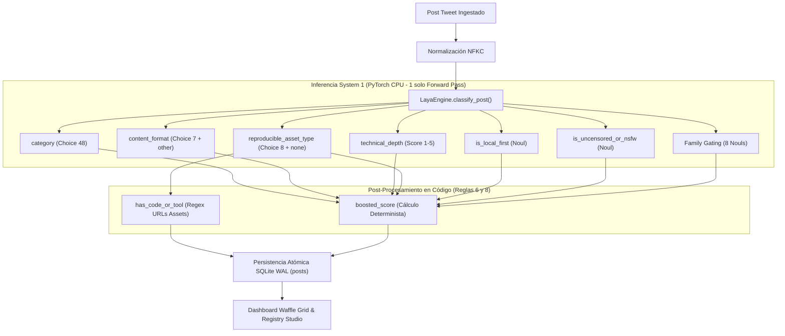

# Plan de Implementación: Subfase 5.14 - Optimización y Rediseño de Preguntas Tipadas System 1 (Jev Questions)

**Versión del Sistema:** v2.1.1 (Laya Decision Engine & JEV Registry Studio)  
**Fecha:** 15 de Octubre, 2026  
**Ámbito:** `backend/data/categories.json`, `backend/app/`, `frontend/`, Obsidian Vault (`Cerebro Digital`)

---

## 1. Visión General del Objetivo

Esta subfase tiene como propósito elevar la calidad discriminativa, reducir la entropía probabilística y optimizar el consumo de cómputo en CPU del pipeline de inferencia **JEV / TypeSafe System One**.

Siguiendo las 9 Reglas de Oro de la skill oficial `jev-questions`, la suite de herramientas analíticas (`lint_questions.py`, `spread.py`, `threshold.py`) y el diagnóstico arquitectónico:
1. **Purgar preguntas redundantes y de ruido muerto:** Eliminar `is_tool_or_code_release` (calculable en código con regex sobre dominios de assets, Reglas 6 y 8) y `sentiment_or_tone` (subjetiva, sin impacto en base de datos ni lógica de negocio).
2. **Rediseñar `content_format` (Choice):** Reducir de 10 opciones solapadas a 6 intenciones comunicativas focales + 1 opción de escape obligatoria (`other`), eliminando los duplicados idénticos (`hot_take` vs `general_discussion`) y resolviendo la advertencia `warn no-escape` de `lint_questions.py`.
3. **Optimizar `technical_depth` (Score 1-5):** Calibrar los 5 niveles como situaciones observables de complejidad técnica (desde memes/humor hasta shaders matemáticos y código de arquitectura).
4. **Blindar preguntas booleanas `is_local_first` e `is_uncensored_or_nsfw` (Noul):** Sustituir listas de palabras clave por descripciones situacionales explícitas para `true` y `false`.
5. **Generar y exportar la Guía Canónica al Vault de Obsidian:** Crear la documentación didáctica enriquecida en `Obsidian/Cerebro Digital/Desarrollo_Software/AppS_JEV/twitter-post-classifier/02_Taxonomia_y_Prompts/GUIA_DISENO_PREGUNTAS_TIPADAS_JEV.md`.
6. **Cache-busting en el Frontend:** Actualizar los enlaces de scripts en `config.html` a `?v=2.1.3` y recompilar artefactos en `frontend/dist/`.

---

## 2. Hallazgos del Análisis con Graphify

Conforme a la **Directiva Suprema "Graph-First Engineering"** (`AGENT.md`), se consultó el grafo de conocimiento (`graphify query`):
- **Radio de Impacto (*Blast Radius*):**
  - `categories.json` es el nodo raíz de taxonomía que alimenta a `load_registry_data()` y `build_decision_schema()` en [`registry.py`](file:///home/patricklinux/Dev/GEMINI-ANTIGRAVITY%20APPS/JEV_APPS/twitter_post_classifier_master/backend/app/registry.py).
  - [`engine.py`](file:///home/patricklinux/Dev/GEMINI-ANTIGRAVITY%20APPS/JEV_APPS/twitter_post_classifier_master/backend/app/engine.py): `classify_post()` consume `content_format`, `technical_depth`, `is_local_first`, `is_uncensored_or_nsfw` y `reproducible_asset_type`. `is_tool_or_code_release` y `sentiment_or_tone` nunca fueron consumidos en el forward pass de Laya.
  - [`schema.py`](file:///home/patricklinux/Dev/GEMINI-ANTIGRAVITY%20APPS/JEV_APPS/twitter_post_classifier_master/backend/app/schema.py) y [`endpoints_posts.py`](file:///home/patricklinux/Dev/GEMINI-ANTIGRAVITY%20APPS/JEV_APPS/twitter_post_classifier_master/backend/app/api/endpoints_posts.py): El campo `is_tool_or_code_release` se mantiene en el modelo de respuesta derivándolo directamente de `has_code_or_tool` para preservar la compatibilidad con clientes externos y tests de API.
  - [`config.html`](file:///home/patricklinux/Dev/GEMINI-ANTIGRAVITY%20APPS/JEV_APPS/twitter_post_classifier_master/frontend/config.html) y [`questions.js`](file:///home/patricklinux/Dev/GEMINI-ANTIGRAVITY%20APPS/JEV_APPS/twitter_post_classifier_master/frontend/js/config/questions.js): El banco de preguntas pasará de mostrar 7 preguntas a 5 preguntas optimizadas, actualizando `tabQuestionsTitle` a "Banco de Preguntas Tipadas (5)".

---

## 3. Diseño de Preguntas y Criterios Jev / System One

### 3.1 `content_format` (Choice con Escape)
- **Instrucción:** `¿Qué acción comunicativa principal está realizando el autor con esta publicación? Elige la opción que describa mejor el propósito del post.`
- **Criterios (situaciones, no palabras):**
  - `launch`: El autor anuncia formalmente la disponibilidad pública de un recurso nuevo (producto, versión, servicio o release).
  - `opensource`: El autor comparte código fuente, repositorio público descargable o librería para que otros la usen o estudien.
  - `builddemo`: El autor muestra el estado visual de algo en desarrollo activo (WIP, canvas interactivo, devlog o prototipo).
  - `explainer`: El autor enseña, explica o desglosa un flujo técnico paso a paso o la arquitectura interna de un sistema.
  - `receipt`: El autor comparte resultados cuantificables de negocio (ingresos, MRR, facturación, crecimiento de usuarios o hitos medibles).
  - `curation`: El autor recopila, recomienda o lista herramientas y recursos útiles creados por terceros.
  - `other`: Publicaciones cotidianas, opiniones personales, debates informales, memes o contenidos que no encajan en las opciones anteriores (Opción de escape obligatoria §3).

### 3.2 `technical_depth` (Score 1-5)
- **Instrucción:** `¿Qué nivel de profundidad o especialización técnica demostrable presenta la publicación?`
- **Niveles situacionales:**
  - `Nivel 1: Divulgación general, memes, humor o reflexiones de opinión sin contenido técnico verificable`
  - `Nivel 2: Demostración visual superficial, captura de pantalla o descripción conceptual sin detalles de implementación`
  - `Nivel 3: Flujo de trabajo técnico aplicable, configuración detallada o metodología reproducible paso a paso`
  - `Nivel 4: Parámetros técnicos avanzados, prompts reproducibles completos, fragmentos de código o configuraciones complejas`
  - `Nivel 5: Repositorio de código fuente completo, arquitectura de software, shaders matemáticos o release formal de ingeniería`

### 3.3 `is_local_first` (Noul)
- **Instrucción:** `¿La publicación enfatiza la capacidad de descargar, desplegar o ejecutar modelos de IA de forma autónoma en hardware propio o entornos locales sin requerir conexión a APIs en la nube?`
- **Criterios:**
  - `true`: El contenido se centra en ejecución local, autoalojamiento (self-hosted), cuantizaciones para inferencia offline o herramientas de ejecución en máquina propia.
  - `false`: El contenido depende de servicios en la nube, APIs remotas propietarias o no aborda la ejecución local autónoma.

### 3.4 `is_uncensored_or_nsfw` (Noul)
- **Instrucción:** `¿La publicación contiene, enlaza o promueve explícitamente contenido erótico para adultos, pornografía o modelos sin censura para generación de desnudez?`
- **Criterios:**
  - `true`: El post incluye imágenes explícitas para adultos, o comparte checkpoints/LoRAs específicamente diseñados para omitir filtros de seguridad en generación erótica.
  - `false`: El post es apto para todo público o aborda arte digital, modelado o tecnología sin componentes eróticos explícitos.

### 3.5 `reproducible_asset_type` (Choice)
- Se mantienen las 8 claves: `github_repo`, `comfyui_workflow`, `huggingface_model`, `civitai_lora`, `installation_guide`, `tutorial_link`, `prompt_share`, `none`.
- Se refinan las descripciones para reflejar situaciones claras de descarga o enlace directo.

---

## 4. Decisiones de Diseño Clave

1. **Persistencia String en `categories.json` vs JSON enriquecido:**
   `LayaEngine` recibe `criteria` como diccionario de strings (`Dict[str, str]`). Por ende, los criterios en `categories.json` se formatean como texto continuo de alta densidad semántica.
2. **Retrocompatibilidad de API:**
   Aunque eliminamos `is_tool_or_code_release` de `categories.json`, el campo se sigue emitiendo en `AnalyzePostResponse` y `PostResponse` calculándolo con `has_code_or_tool` en código, evitando regresiones en tests existentes.
3. **Versionado de Assets Frontend (Cache-Busting):**
   Se elevan los tags de script a `?v=2.1.3` en `config.html` y se regenera `frontend/dist/`.

---

## 5. Diagrama de Arquitectura / Flujo (Mermaid)



---

## 6. Cambios Propuestos por Componente

| Componente | Archivo | Modificación |
|---|---|---|
| **Taxonomía JSON** | `backend/data/categories.json` | Purgar 2 preguntas obsoletas, reescribir 5 preguntas conforme a reglas Jev, actualizar `fallback_format: "other"`. |
| **Backend Engine** | `backend/app/engine.py` | Asegurar fallback de `content_format` a `"other"` si es desconocido. |
| **Backend Schema** | `backend/app/schema.py` | Preservar `is_tool_or_code_release` computado en código para retrocompatibilidad. |
| **Frontend HTML** | `frontend/config.html` | Actualizar contador a `(5)`, cache-busting a `?v=2.1.3`. |
| **Frontend State** | `frontend/js/config/state.js` | Sincronizar `PROTECTED_QUESTIONS = ['content_format', 'technical_depth', 'reproducible_asset_type']`. |
| **Frontend Compilado**| `frontend/dist/` | Re-compilar con `scripts/build_frontend.py`. |
| **Obsidian Vault** | `Obsidian/Cerebro Digital/.../GUIA_DISENO_PREGUNTAS_TIPADAS_JEV.md` | Guía de referencia exhaustiva para el Vault del usuario. |

---

## 7. Plan de Pruebas y Verificación

1. **Linter Oficial Jev:**
   ```bash
   python3 ~/.agents/skills/jev-questions/scripts/lint_questions.py backend/data/categories.json
   ```
   *Debe arrojar 0 advertencias.*
2. **Suite de Pruebas Backend:**
   ```bash
   pytest tests/test_categories.py tests/test_categories_crud.py tests/test_engine.py
   ```
3. **Compilación Frontend:**
   ```bash
   python3 scripts/build_frontend.py
   ```
4. **Validación E2E en Navegador con Playwright:**
   Verificar que `/config` cargue el banco con las 5 preguntas y que la selección de pestañas funcione limpiamente.
5. **Sincronización del Grafo:**
   ```bash
   graphify --update
   ```
