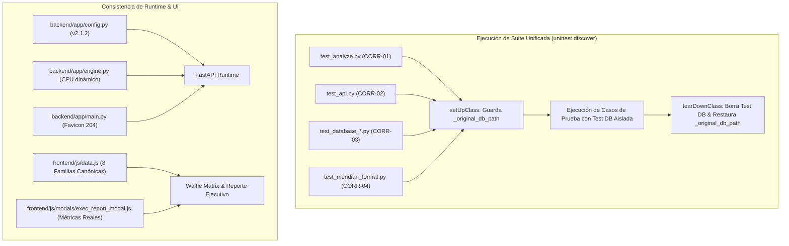

# Plan de Implementación: Subfase 5.15 - Endurecimiento de la Suite de Pruebas, Aislamiento de Base de Datos y Coherencia Taxonómica Frontend

**Versión del Sistema:** v2.1.2 (Laya Decision Engine & JEV Registry Studio)  
**Fecha:** 16 de Octubre, 2026  
**Ámbito:** `tests/`, `backend/app/`, `frontend/`, `documentacion/`  
**Objetivo Primario:** Resolver las 10 observaciones del análisis forense (CORR-01 a CORR-10), elevar la suite de pruebas a **100% exitosa (60/60)**, blindar el aislamiento de persistencia y sincronizar la taxonomía en el frontend.

---

## 1. Visión General del Objetivo

Esta subfase tiene como propósito erradicar la deuda técnica, las aserciones obsoletas y los acoplamientos de estado descubiertos durante el análisis forense exhaustivo:
1. **CORR-01:** Corregir `tests/test_analyze.py` para alinear la validación de entrada con la sanitización tolerante de emojis y textos vacíos de la Subfase 5.13.1, manteniendo la prueba de HTTP 422 para cargas verdaderamente inválidas (faltantes o incompatibles).
2. **CORR-02:** Corregir `tests/test_api.py` actualizando la aserción de versión a `"2.1.1"`.
3. **CORR-03:** Blindar el aislamiento de `settings.DATABASE_PATH` en todas las clases de prueba (`setUpClass` / `tearDownClass`) para prevenir la contaminación cruzada o borrado involuntario de bases de datos.
4. **CORR-04:** Convertir `tests/test_meridian_format.py` a una clase `unittest.TestCase` formal para que sea descubierta e integrada al runner oficial.
5. **CORR-05:** Sincronizar las 8 familias maestras canónicas de `categories.json` con `ROOT_FAMILIES` en `frontend/js/data.js` (incorporando `ia_generativa`, `modelos_ia`, `agentes_ia` y reclasificando `negocios_saas`).
6. **CORR-06:** Purgar los fallbacks residuales de `general_discussion` hacia `"other"` en `backend/app/database.py` y `frontend/js/data.js`.
7. **CORR-07:** Conectar `frontend/js/modals/exec_report_modal.js` a métricas agregadas reales de las publicaciones en SQLite en lugar de propiedades sintéticas mock.
8. **CORR-08:** Implementar detección dinámica del modelo de CPU en `backend/app/engine.py` en lugar del texto fijo quemado.
9. **CORR-09:** Agregar manejador para `/favicon.ico` en `backend/app/main.py` y unificar el versionado de cache-busting en `frontend/index.html` a `?v=2.1.3`.
10. **CORR-10:** Redactar y archivar `documentacion/RESUMEN_SUBFASE_5_13.md` para cerrar la brecha documental de las subfases 5.13.1 y 5.13.2.

---

## 2. Hallazgos del Análisis con Graphify

Conforme a la Directiva Suprema de `AGENT.md`, se consultó el grafo de dependencias:
- **Nodos Auditados:**
  - `TestAnalyzeEndpoint`, `TestApiEndpoints`, `TestDatabaseManagement`, `TestOverridePending`.
  - `settings.DATABASE_PATH`: Nodo de configuración central con 34 aristas directas/indirectas. Su mutación sin restauración en `tearDownClass` contamina el estado global del proceso.
  - `ROOT_FAMILIES` y `CATEGORIES` en `frontend/js/data.js`: Nodos puente que alimentan la matriz Waffle (`matrix.js`), el cuadrante Scatter (`views.js`) y el selector de familias en el Drawer (`drawer.js`).
  - `ExecReportModal` en `frontend/js/modals/exec_report_modal.js`: Nodo de visualización desacoplado que actualmente lee propiedades objetivo (`avgLikesTarget`) en lugar del almacén reactivo `AppState`.
- **Contratos que deben preservarse intactos:**
  - Las firmas de `AnalyzePostRequest` y `AnalyzePostResponse` en `schema.py`.
  - El DDL de `posts` y `post_classification_history` en `database.py`.
  - La compatibilidad con el formato exportado por Meridian Scraper v2.

---

## 3. Decisiones de Diseño Clave

1. **Aislamiento Seguro de Base de Datos en Tests:**
   Cada test que redirija `settings.DATABASE_PATH` debe guardar `cls._original_db_path = settings.DATABASE_PATH` antes de modificarlo, y restaurarlo incondicionalmente en `tearDownClass` dentro de un bloque `try...finally`.
2. **Semántica de Validación en `AnalyzePostRequest`:**
   La sanitización de 5.13.1 convierte `text="   "` o emojis individuales en contenido procesable (`"[Sin contenido textual]"`), lo cual previene caídas en scrapers ruidosos. Para verificar HTTP 422, la prueba debe enviar payloads sin el campo obligatorio `text` (`json={}`) o con tipos de datos incompatibles.
3. **Métricas Reales en Reporte Ejecutivo:**
   `exec_report_modal.js` iterará sobre `posts` reales (`window.AppState.getPosts()` o `window.currentScrapedPosts`). Si no hay posts en la base de datos, mostrará un estado vacío informativo en vez de números ficticios.
4. **Detección Dinámica de CPU:**
   Se leerá `/proc/cpuinfo` (Linux) con fallback a `platform.processor()` y `os.cpu_count()`. En `test_api.py`, la aserción se flexibilizará para verificar que el string de procesador no sea nulo ni vacío y contenga el identificador general de arquitectura.

---

## 4. Diagrama de Flujo y Aislamiento (Mermaid)

---

## 5. Cambios Propuestos por Componente

### 5.1 Pruebas y Aislamiento de Persistencia (Backend Tests)

#### `tests/test_analyze.py` (CORR-01 & CORR-03)
- Guardar y restaurar `settings.DATABASE_PATH` en `setUpClass` / `tearDownClass`.
- Actualizar `test_analyze_invalid_input` para enviar `json={}` (sin el campo `text` obligatorio) y verificar HTTP 422.
- Añadir `test_analyze_empty_text_sanitization` para verificar que `text="   "` sea sanitizado a `"[Sin contenido textual]"` con HTTP 200.

#### `tests/test_api.py` (CORR-02 & CORR-03)
- Actualizar aserción de `data["registry_version"]` a `"2.1.1"`.
- Añadir `tearDownClass` con restauración de `settings.DATABASE_PATH` y limpieza de archivos temporales `test_api.sqlite*`.
- Ajustar aserción de `cpu_model` para admitir detección dinámica.

#### `tests/test_override_pending.py`, `tests/test_batch_stream.py`, `tests/test_database_management.py`, `tests/test_subfase_5_13_1.py`, `tests/test_database.py`, `tests/test_services.py` (CORR-03)
- Añadir guardado y restauración incondicional de `settings.DATABASE_PATH` en `setUpClass` / `tearDownClass` (o `asyncSetUp` / `asyncTearDown`).

#### `tests/test_meridian_format.py` (CORR-04)
- Envolver las funciones en la clase `class TestMeridianFormat(unittest.TestCase)` para su descubrimiento automático.

### 5.2 Backend Core & Configuración

#### `backend/app/engine.py` (CORR-08)
- Implementar función auxiliar `_detect_cpu_model()` que inspecciona `/proc/cpuinfo` y `platform.processor()`.

#### `backend/app/database.py` (CORR-06)
- Actualizar `DEFAULT_POST_VALUES["format"]` de `"general_discussion"` a `"other"`.

#### `backend/app/main.py` (CORR-09)
- Agregar endpoint `@app.get("/favicon.ico", include_in_schema=False)` retornando `Response(status_code=204)`.

### 5.3 Frontend & Experiencia de Usuario

#### `frontend/js/data.js` (CORR-05 & CORR-06)
- Actualizar `ROOT_FAMILIES` con las 8 familias maestras canónicas: `ia`, `ia_generativa`, `modelos_ia`, `agentes_ia`, `modelado_3d`, `juegos`, `dev_tools`, `mangas` y el fallback `otros`.
- Actualizar los fallbacks de formato en `formatAppPost()` de `'general_discussion'` a `'other'`.

#### `frontend/js/modals/exec_report_modal.js` (CORR-07)
- Modificar `renderContent()` para calcular totales reales, categorías con mayor engagement promedio y volúmenes a partir de las publicaciones cargadas en `posts`.
- Mostrar un estado vacío descriptivo si `posts.length === 0`.

#### `frontend/index.html` y `frontend/dist/` (CORR-09)
- Elevar la versión de los bundles de scripts de `?v=2.1.2` a `?v=2.1.3`.
- Recompilar artefactos con `python3 scripts/build_frontend.py`.

### 5.4 Documentación Histórica

#### `documentacion/RESUMEN_SUBFASE_5_13.md` (CORR-10)
- Documentar las implementaciones de Subfase 5.13.1 (Unicode emojis, sanitización) y 5.13.2 (Gestión integral de base de datos SQLite WAL).

---

## 6. Plan de Pruebas y Verificación

1. **Suite Completa Automatizada:**
   Ejecutar `../laya_tester_app/.venv/bin/python3 -m unittest discover tests` y verificar que **100% de las pruebas (60/60) pasen exitosamente con 0 errores y 0 fallos**.
2. **Verificación de Aislamiento de Persistencia:**
   Confirmar que tras correr toda la suite de pruebas, `backend/data/database.sqlite` mantiene su estado intacto y no fue borrado ni alterado por los tests.
3. **Verificación de Linter Jev:**
   Ejecutar `python3 ~/.agents/skills/jev-questions/scripts/lint_questions.py backend/data/categories.json` verificando 0 findings.
4. **Verificación E2E con Playwright:**
   Comprobar en Brave que `/` y `/config` no emiten errores 404 ni excepciones de consola.
