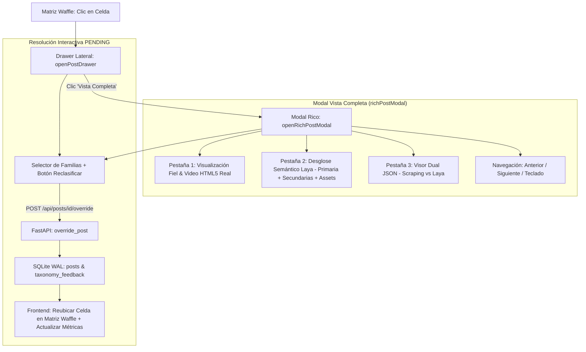

# Plan de Implementación: Subfase 5.8 - Drawer Lateral Multimedia, Vista Completa y Resolución Interactiva PENDING

## 1. Visión General del Objetivo

El objetivo de esta subfase es transformar el **Drawer Lateral de Inspección** y el **Modal de Vista Completa (`#richPostModal`)** en herramientas profesionales de auditoría analítica y supervisión humana. Actualmente, la vista completa presenta datos simulados, un bucle de 48 barras falsas de 35% en la pestaña semántica, ausencia de renderizado de video MP4 real para posts de Meridian y un JSON formateado solo con propiedades internas del frontend.

Con esta implementación logramos:
1. **Visualización Fiel y Multimedia Real (Pestaña 1):** Renderizado de reproductores HTML5 reales para videos MP4 (`media_urls[0]`), galerías para fotos múltiples, avatar, verified badge y métricas verídicas de scraping.
2. **Desglose Semántico Fiel Laya System 1 (Pestaña 2):** Sustituir el bucle de 48 barras ficticias por la matriz real de afinidad calculada por Laya (Categoría Primaria, Categorías Secundarias en competencia, Familia Raíz, Activos/Dominios detectados como GitHub/Blender/Mixamo, Profundidad Técnica y Formato).
3. **Visor Dual de Raw JSON (Pestaña 3):** Alternar fluidamente entre el **JSON Original de Scraping (Meridian)** y el **JSON de Salida de Laya AI**, con resaltado de sintaxis y botones de copiar y descargar.
4. **Resolución Interactiva de PENDING y Reclasificación en Vivo:** Integración bidireccional con el backend (`POST /api/posts/{id}/override`), actualizando SQLite WAL, la tabla `taxonomy_feedback`, la fila correspondiente en la Matriz Waffle y el Drawer sin recargar la página.
5. **Navegación Secuencial y Filtro de Auditoría:** Controles `[← Anterior]` / `[Siguiente →]` dentro de la vista completa y chip de filtro para publicaciones `PENDING` o anomalías.

---

## 2. Decisiones de Diseño Clave

1. **Selector de Reclasificación Organizado por Familias Maestras (`<optgroup>`):**
   Para evitar listas desordenadas de 48 categorías en el dropdown, agrupamos las opciones mediante etiquetas `<optgroup>` según las 8 familias raíz (`Inteligencia Artificial`, `Desarrollo & Herramientas`, `Startups & Negocios`, etc.), mostrando el código y el color oficial.
   
2. **Visor Dual de JSON en Pestaña 3:**
   Interruptor de dos vistas:
   - **Scraping Original (Meridian):** El objeto fuente tal como fue extraído (`author: {...}`, `metrics: {...}`, `media_urls: [...]`).
   - **Clasificación Laya (System 1 Output):** El resultado analítico del backend con afinidad, categorías secundarias, latencia de inferencia y formato.
   
3. **Reproductor de Video MP4 con Manejo de Restricciones CORS de Twitter:**
   Los videos MP4 de X/Twitter alojados en `video.twimg.com` se reproducirán directamente con `<video controls>`. En caso de que las políticas de red del navegador del usuario restrinjan la reproducción de ciertos dominios CDN de X, se provee un botón directo *"Abrir video en pestaña nueva"* y *"Ver tweet en x.com"*.

4. **Resolución en Caliente de PENDING:**
   Al reclasificar un tweet, se llama a `POST /api/posts/{id}/override`. El backend actualiza `posts` a `CLASSIFIED_MANUAL`, registra la decisión en `taxonomy_feedback` para aprendizaje activo, y el frontend reubica la celda en la Matriz Waffle en caliente sin recargar la página.

---

## 3. Cambios Propuestos por Componente

### Componente Backend: Endpoints y Base de Datos
- **`backend/app/api/endpoints_posts.py`**:
  - Función auxiliar `_format_post_response(post_data)` para normalizar el retorno de posts sin duplicidad de código.
  - En `override_post`:
    - Ejecutar `resolve_pending_post` para actualizar el post en `posts` y alimentar `taxonomy_feedback`.
    - Consultar el post recién actualizado mediante `find_post_by_id`.
    - Retornar el post actualizado con su esquema completo (`PostResponse`) dentro del payload de respuesta, preservando retrocompatibilidad con tests existentes (`status`, `primary_category`, `tweet_id`).
  - Asegurar que `GET /api/posts` y `GET /api/posts/{id}` continúen devolviendo siempre `date`, `post_url`, `media_urls` y `secondary_categories`.

### Componente Frontend: Interfaz y Estilos
- **`frontend/index.html`**:
  - Filtro rápido `PENDING`: botón con contador reactivo `#filterPendingCount`.
  - Drawer lateral (`#postDrawer`):
    - Badge de estado con estilo dinámico (`CLASSIFIED` verde, `PENDING` ámbar con pulso, `CLASSIFIED_MANUAL` azul).
    - Selector `#drawerReclassifySelect` adaptado para recibir `<optgroup>` por Familias Maestras.
    - Botón de reclasificación rápida *"Confirmar / Mover"*.
    - Vista previa multimedia real.
  - Modal de Vista Completa (`#richPostModal`):
    - Encabezado con estado del post, controles de navegación `[← Post Anterior]` / `[Siguiente Post →]` y contador `Post X de Y`.
    - **Pestaña 1:** Reproductor `<video id="modalHtmlVideoPlayer" controls playsinline>`, galería multi-foto, fallback CORS y datos verídicos de autor.
    - **Pestaña 2:** Desglose semántico fiel sin las 48 barras falsas, con afinidad ganadora, secundarias en competencia, familia raíz, assets/chips y banner de auditoría humana.
    - **Pestaña 3:** Visor dual de JSON (Meridian Scraping vs Laya Engine Output) con botones de copiar y descargar `.json`.
    - Barra inferior de reclasificación directa desde el modal.
- **`frontend/css/styles.css`**:
  - Estilos para celdas `.tile-pending` con borde y pulso ámbar.
  - Estilos para galería multimedia y fallback CORS.

### Componente Frontend: Lógica y Controladores
- **`frontend/js/data.js`**:
  - Normalización unificada para asegurar que los posts preserven `media_urls`, `media_type`, `post_url`, `author_nick`, `verified`, `status`, `secondary_categories`, `assets`, `technical_depth`, `format`, `raw_scraping` y `laya_output`.
- **`frontend/js/drawer.js`**:
  - Implementación de `openPostDrawer` con metadatos reales y selector con `<optgroup>`.
  - Implementación de `openRichPostModal` con reproductor HTML5 real, desglose semántico fiel y visor dual de JSON.
  - Navegación secuencial (`navigateModalPost`) y atajos de teclado (`ArrowLeft`, `ArrowRight`, `Escape`).
  - Resolución interactiva de PENDING vía `POST /api/posts/{id}/override` con actualización en caliente de la Matriz Waffle.
- **`frontend/js/matrix.js`**:
  - Soporte para filtro `data-filter="pending"`.
  - Clase visual `.tile-pending`.
  - Conteo de `#filterPendingCount`.
- **`frontend/js/modals.js`**:
  - Preservación completa de propiedades en análisis individual y por lotes.

---

## 4. Plan de Verificación

### Pruebas Automatizadas
1. **Prueba Unitaria Backend (`tests/test_override_pending.py`):**
   - Insertar post en estado `PENDING` en SQLite WAL.
   - Ejecutar `POST /api/posts/{id}/override`.
   - Verificar persistencia en tabla `posts` (`status = 'CLASSIFIED_MANUAL'`) e inserción en `taxonomy_feedback`.
2. **Prueba End-to-End con Playwright (`scratch/test_drawer_full_view.py` y `playwright-cli`):**
   - Ingestar posts Meridian reales con video MP4.
   - Probar apertura de Drawer y Vista Completa.
   - Verificar Pestaña 1 (video real), Pestaña 2 (semántica fiel sin 48 barras), Pestaña 3 (dual JSON con botón copiar/descargar).
   - Probar navegación secuencial (botones y teclado).
   - Probar reclasificación manual en caliente y movimiento en la Matriz Waffle.
   - Capturar screenshots para el walkthrough.
