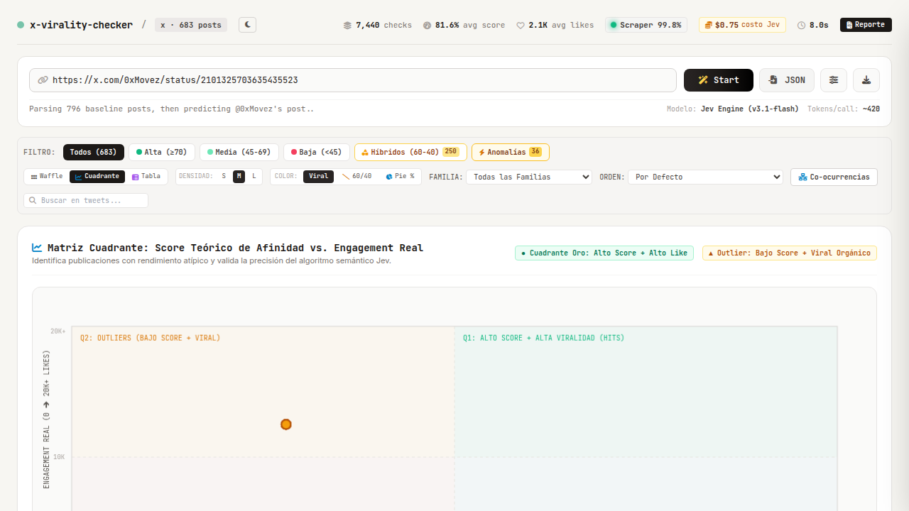
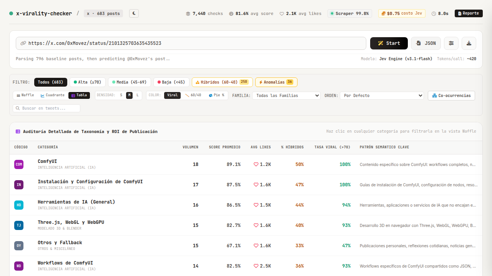

# Resumen Ejecutivo - Subfase 5.3: Cuadrante Scatter Canvas 2D y Vista Tabular

**Proyecto:** `twitter_post_classifier_master`  
**Fecha:** 14 de Octubre de 2026  
**Estado:** Completado con Éxito (100% de Pruebas Unitarias y Validación en Navegador Playwright Aprobadas)  

---

## 1. Objetivos Alcanzados en la Subfase 5.3

### A. Cuadrante Scatter en Canvas 2D (`views.js` & `#scatterCanvas`)
1. **Ejes Cartesianos y Mapeo Bidimensional:**
   - **Eje X (Horizontal):** Score Teórico de Afinidad Semántica (0% a 100%).
   - **Eje Y (Vertical):** Engagement Real de Publicaciones (0 a 20.000+ likes).
   - Ejes calibrados con escala DPR para pantallas Retina / HiDPI sin distorsión de píxeles.
   - Líneas divisorias punteadas en el punto medio (Score 50% y engagement promedio).

2. **Zonificación Analítica de los 4 Cuadrantes:**
   - **Q1 (Superior Derecho):** *ALTO SCORE + ALTA VIRALIDAD (Hits)* - Fondo tintado verde esmeralda. Publicaciones donde la predicción de System 1 se correlaciona con éxito viral.
   - **Q2 (Superior Izquierdo):** *OUTLIERS (BAJO SCORE + VIRAL)* - Fondo tintado ámbar. Publicaciones con bajo score semántico pero alta difusión orgánica atípica.
   - **Q3 (Inferior Izquierdo):** *DESALINEADOS / FLOP* - Fondo tintado rojo tenue. Posts con baja afinidad y bajo impacto.
   - **Q4 (Inferior Derecho):** *GEMAS DE NICHO (ALTO SCORE / MENOR ALCANCE)* - Fondo tintado azul cielo. Contenido técnicamente valioso pero con menor tracción de algoritmo en X.

3. **Renderizado de Puntos de Dispersión y Soporte Multiclase:**
   - Color del núcleo según la categoría primaria en `CATEGORY_COLOR_MAP`.
   - Para posts híbridos (60/40), se renderiza un anillo perimetral con el color de la categoría secundaria (`secondary_cat_id`).
   - Para Outliers / Anomalías algorítmicas, radio ampliado (r=6.5) y borde ámbar brillante con pulso visual.
   - Sincronización con el selector de familias (`#familyFilterSelect`): al filtrar por una familia, los puntos de las demás familias se ocultan o atenúan.

4. **Tooltip Interactivo y Apertura de Drawer:**
   - Detección precisa de cursor en el Canvas mediante cálculo de distancia euclidiana `Math.hypot(pt.x - mouseX, pt.y - mouseY)`.
   - Tooltip flotante `#scatterTooltip` con:
     - Avatar y autor (`@username`).
     - Badge de afinidad (% afinidad).
     - Vista previa del contenido del tweet.
     - Insignia de categoría con desglose secundario (ej. `+ 35% IA Local`).
     - Contador de likes con icono de corazón.
   - Al hacer clic en cualquier punto del Canvas, se abre automáticamente el **Drawer Lateral de Inspección** con la publicación correspondiente.

---

### B. Vista de Tabla Ejecutiva Analítica (`renderTableView`)
1. **Estructura y Métricas Clave:**
   - Lista todas las categorías ordenadas por volumen de publicaciones descendente.
   - Muestra 8 columnas analíticas:
     1. **Código:** Badge con color hexadecimal calibrado y código corto.
     2. **Categoría & Familia:** Nombre legible y etiqueta de la familia raíz.
     3. **Volumen:** Cantidad total de posts analizados en la categoría.
     4. **Score Promedio:** % de afinidad media calculada sobre los posts.
     5. **Avg Likes:** Promedio real de engagement por tweet.
     6. **% Híbridos:** Proporción de posts multiclase (60/40).
     7. **Tasa Viral (>70):** Porcentaje de publicaciones con score >= 70%.
     8. **Patrón Semántico Clave:** Criterio descriptivo o palabras clave de activación.

2. **Interacción y Filtrado Rápido:**
   - Al hacer clic en cualquier fila de la tabla, filtra la aplicación por esa categoría, cambia automáticamente a la vista Waffle y muestra una notificación Toast.

---

### C. Conmutación Fluida entre Vistas Principales (`switchMainView`)
- Pestañas superiores accesibles:
  - **Waffle:** Matriz de cuadrícula multicelular (Subfase 5.2).
  - **Cuadrante:** Gráfico cartesiano de dispersión interactivo en Canvas 2D.
  - **Tabla:** Auditoría tabular ejecutiva por columnas.
- Mantiene los estados de ordenación, densidades, filtros de búsqueda y temas (Modo Claro / Modo Oscuro).

---

## 2. Validación con Playwright en Navegador

- Servidor activo con `./status_app.sh` (PID daemon con `setsid`).
- Conmutación a vista Cuadrante Scatter: `#scatterViewContainer` visible, Canvas renderizado con **683 puntos de datos**.
- Interacción con cursor: evento `mousemove` disparado en coordenadas del punto 10 (`@DrArcade_`, categoría `otros`, 20% afinidad, 399 likes) -> Tooltip `#scatterTooltip` desplegado con precisión.
- Conmutación a vista Tabla Ejecutiva: `#tableViewContainer` visible con **48 filas de categorías** tabuladas.
- Clic en primera fila de la tabla -> Transición fluida a vista `"waffle"` con filtro aplicado.
- Capturas de pantalla guardadas y copiadas:
  - **Canvas 2D con los 4 Cuadrantes (Afinidad vs Engagement):**  
    
  - **Canvas con Tooltip Flotante Interactivo:**  
    
  - **Tabla Ejecutiva con Desglose de ROI y Métricas:**  
    

---

## 3. Próximo Paso: Subfase 5.4

- **Subfase 5.4:** Drawer Lateral Multimedia y Modales Operativos (Resolución de PENDING con feedback a Laya y Consola de Streaming SSE).
