# Catálogo de Evidencias Visuales y Capturas E2E

**Ubicación:** `documentacion/imagenes/`  
**Acceso alternativo:** `documentacion/images/` (enlace simbólico)  
**Proyecto:** `twitter-post-classifier-master`  
**Última actualización:** 17 de Octubre de 2026  

Este directorio contiene las capturas de pantalla oficiales generadas durante los ciclos de verificación y pruebas automatizadas End-to-End con Playwright sobre el navegador y la interfaz del sistema.

---

## Índice de Capturas por Fase y Subfase

### 1. Subfase 5.1 — Plantilla Base y Gestor de Taxonomía
Documento de referencia: [`RESUMEN_SUBFASE_5_1.md`](../RESUMEN_SUBFASE_5_1.md)

| Archivo | Descripción | Vista Previa |
| :--- | :--- | :---: |
| `taxonomy_modal.png` | Despliegue inicial del modal de taxonomía `#taxonomyModal` con las 47 categorías del registro JSON. | 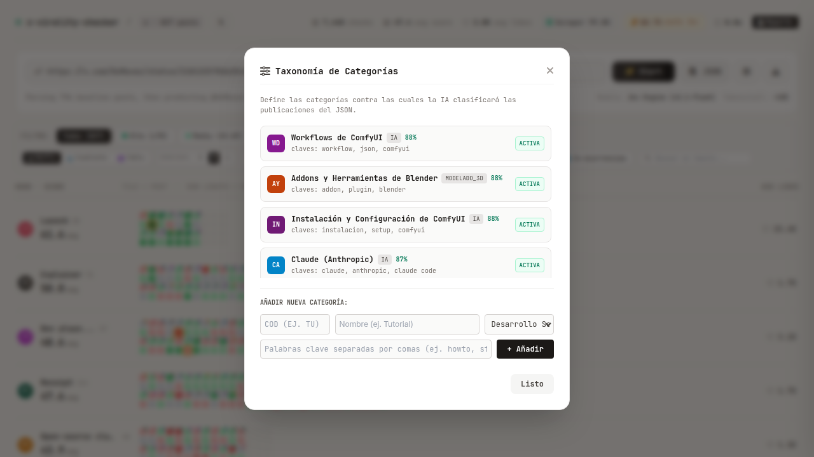 |
| `taxonomy_modal_after_add.png` | Verificación en caliente tras la creación interactiva de la categoría `VFX Compositing` (actualizado a 48 categorías). | 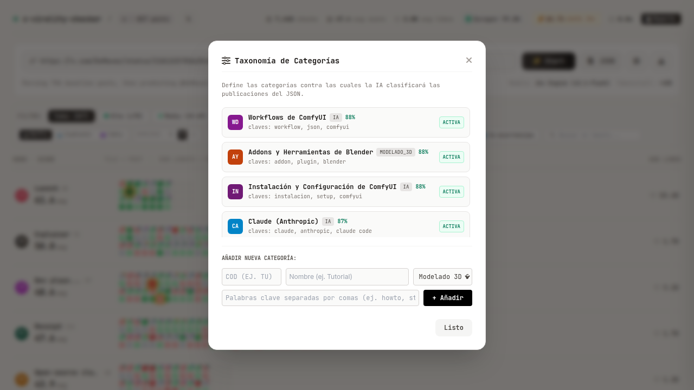 |

---

### 2. Subfase 5.2 — Renderizado Dinámico del Waffle Grid
Documento de referencia: [`RESUMEN_SUBFASE_5_2.md`](../RESUMEN_SUBFASE_5_2.md)

| Archivo | Descripción | Vista Previa |
| :--- | :--- | :---: |
| `waffle_grid_dynamic_48.png` | Renderizado de las 48 filas de categorías agrupadas por sus 8 familias maestras. | 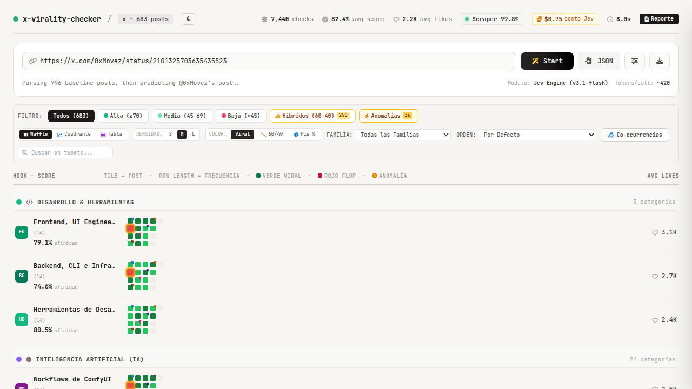 |
| `waffle_grid_family_3d.png` | Filtrado activo por la familia `modelado_3d` mostrando 9 filas especializadas. | 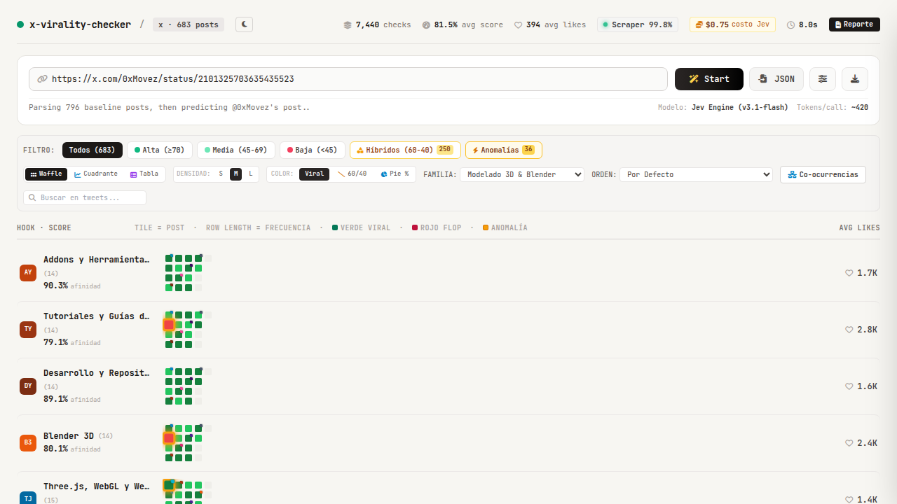 |
| `waffle_grid_split_large.png` | Vista conmutada a densidad `L` y visualización diagonal `60/40`. | 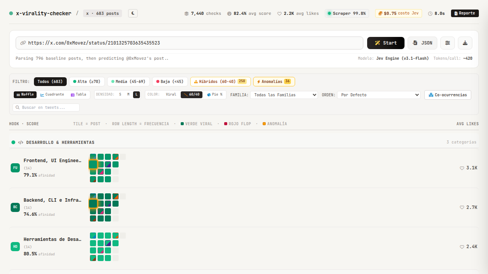 |

---

### 3. Subfase 5.3 — Cuadrante Scatter Canvas 2D y Vista Tabular Ejecutiva
Documento de referencia: [`RESUMEN_SUBFASE_5_3.md`](../RESUMEN_SUBFASE_5_3.md)

| Archivo | Descripción | Vista Previa |
| :--- | :--- | :---: |
| `scatter_quadrant_canvas.png` | Renderizado en Canvas 2D con los 4 cuadrantes analíticos (Afinidad vs Engagement). |  |
| `scatter_with_tooltip.png` | Interacción con cursor mostrando el tooltip flotante `#scatterTooltip` sobre el punto de datos. |  |
| `executive_table_view.png` | Vista tabular ejecutiva `#tableViewContainer` con cálculo dinámico de ROI y métricas. |  |

---

### 4. Subfase 5.8 — Drawer Lateral y Resolución Interactiva de PENDING
Documento de referencia: [`RESUMEN_SUBFASE_5_8.md`](../RESUMEN_SUBFASE_5_8.md)

| Archivo | Descripción | Vista Previa |
| :--- | :--- | :---: |
| `subfase_5_8_01_matrix_waffle.png` | Matriz Waffle con detección automática y aislamiento visual de publicaciones en estado `PENDING`. | 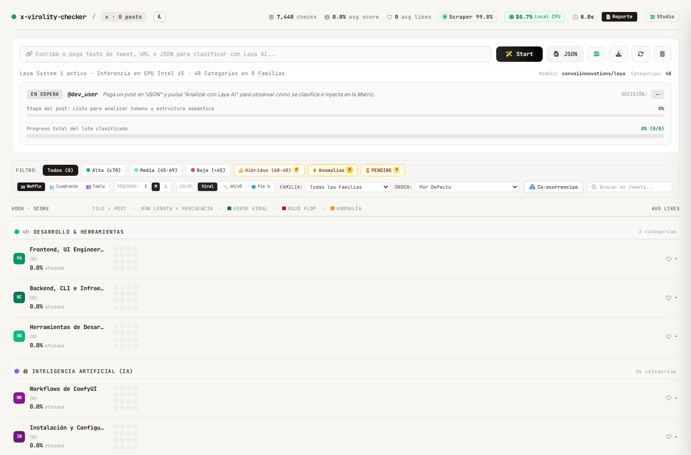 |

---

### 5. Subfase 5.14 — JEV Registry Studio v2.1.0 (Preguntas Tipadas y Base de Datos)
Documento de referencia: [`RESUMEN_SUBFASE_5_14.md`](../RESUMEN_SUBFASE_5_14.md)

| Archivo | Descripción | Vista Previa |
| :--- | :--- | :---: |
| `subfase_5_14_questions_tab.png` | Pestaña de Banco de Preguntas Tipadas System 1 (Choice, Score 1-5, Noul). | 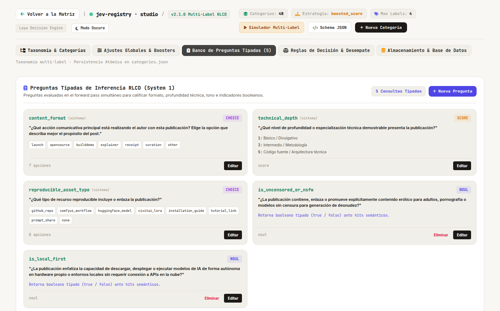 |
| `subfase_5_14_database_tab.png` | Pestaña de Almacenamiento y Métricas de SQLite WAL (tamaño, transacciones, optimización). | 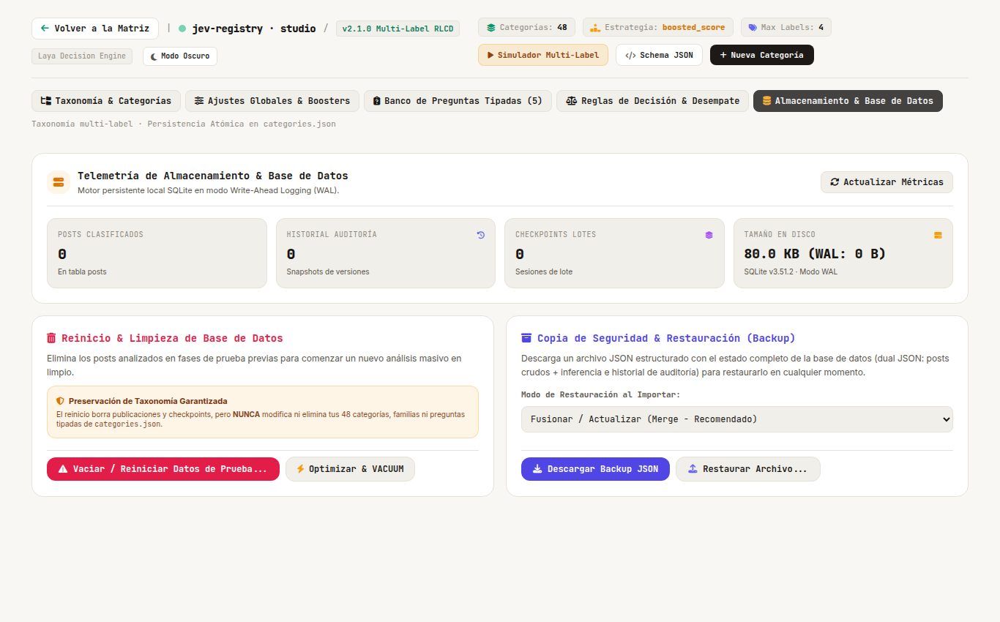 |
| `db_tab_verified.png` | Verificación de persistencia atómica y estado de base de datos. | 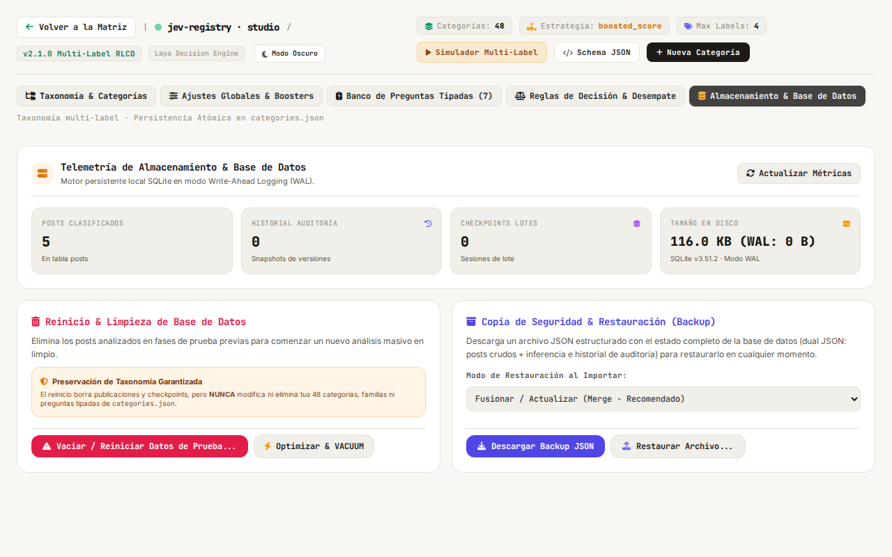 |

---

### 6. Fase 6 — Ingesta Masiva, Streaming SSE en Vivo y Reporte Estratégico
Documento de referencia: [`RESUMEN_FASE_6.md`](../RESUMEN_FASE_6.md) y [`PLAN_FASE_6_INGESTA_MASIVA.md`](../PLAN_FASE_6_INGESTA_MASIVA.md)

| Archivo | Descripción | Vista Previa |
| :--- | :--- | :---: |
| `fase6_ingest_modal.png` | Modal de Ingesta Masiva `#ingestModal` con carga y deduplicación del dataset de 1,683 posts. | 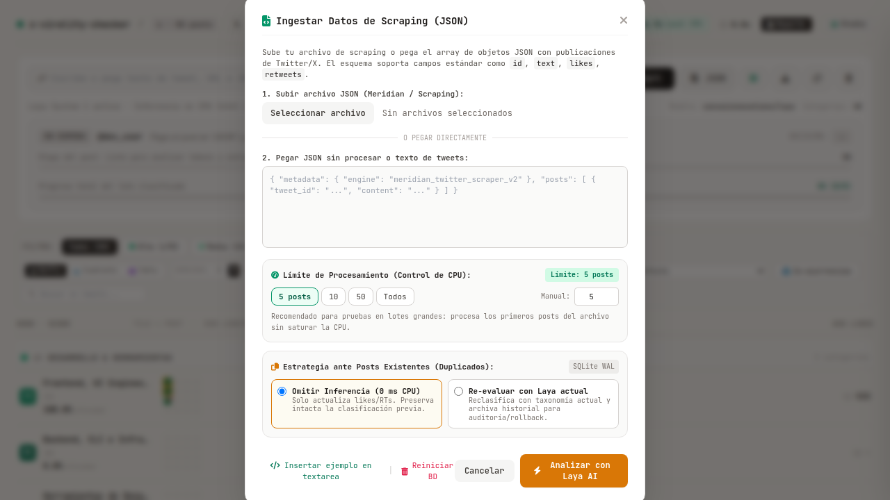 |
| `fase6_live_stream_in_progress.png` | Streaming SSE en tiempo real: Barra de progreso global y micro-barra del post activo. | 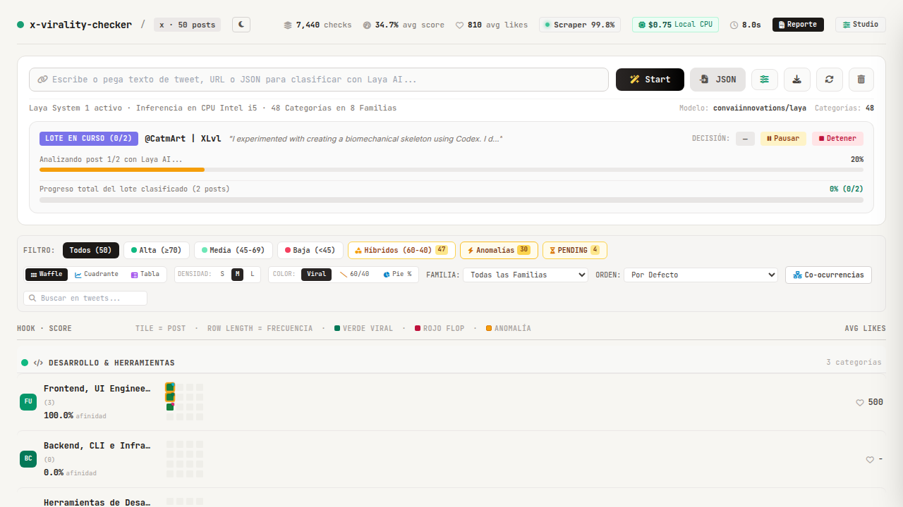 |
| `fase6_live_stream_post2.png` | Streaming SSE: Análisis del segundo post y cambio reactivo de insignias semánticas. | 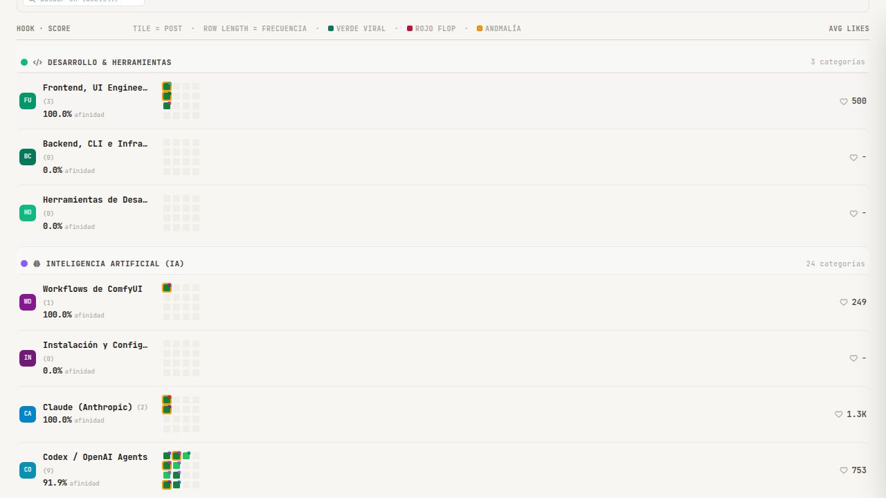 |
| `fase6_live_stream_completed.png` | Streaming SSE: Finalización al 100% con persistencia atómica en SQLite WAL. | 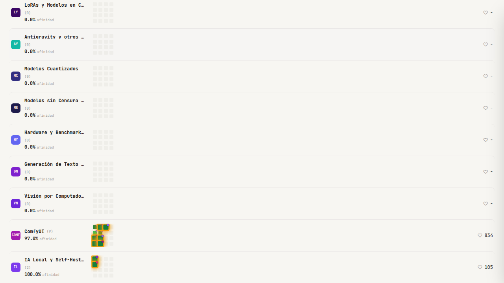 |
| `fase6_live_dashboard.png` | Dashboard principal en vivo con publicaciones inyectadas reactivamente en la Matriz Waffle. | 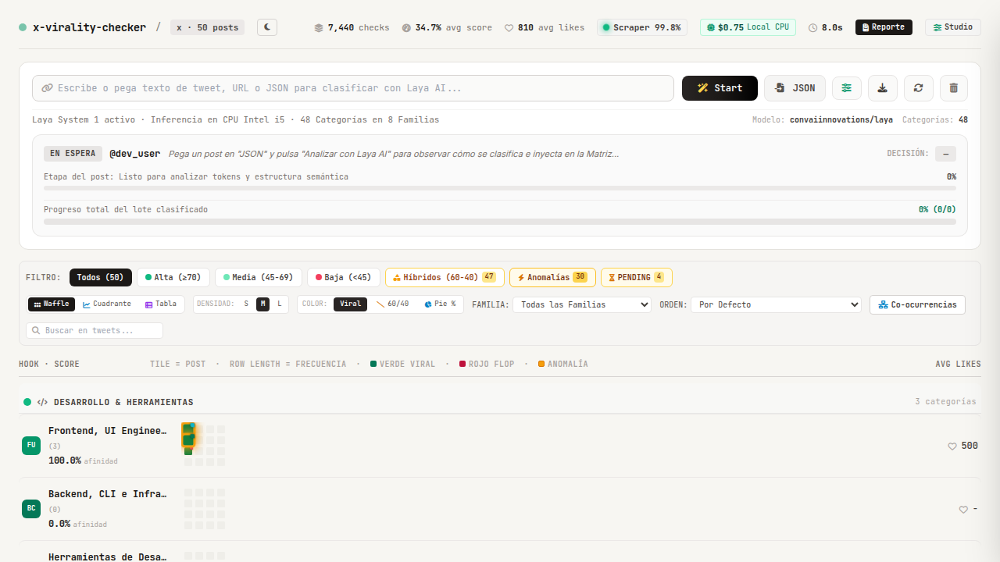 |
| `fase6_exec_report_modal.png` | Modal de Reporte Estratégico Ejecutivo `#execReportModal` con métricas de engagement consolidado. | 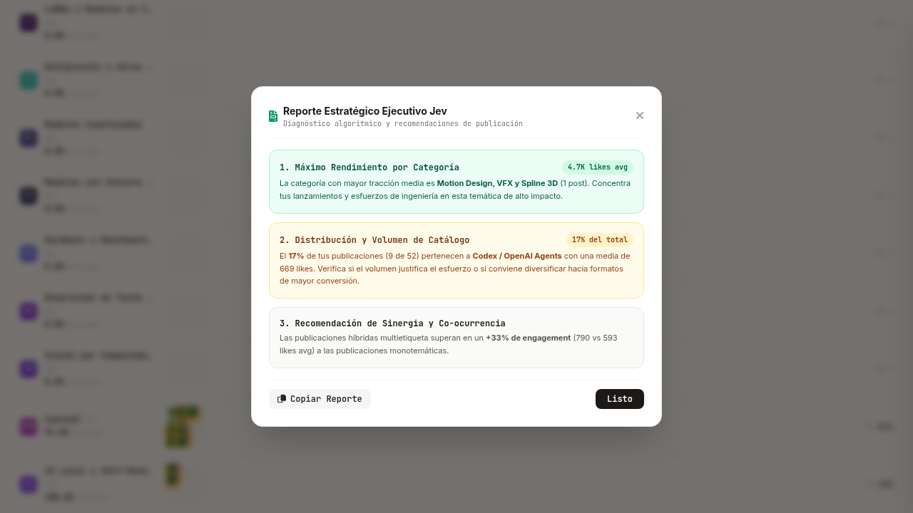 |
